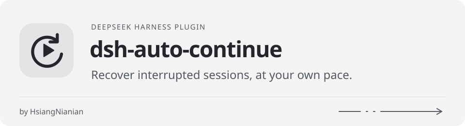
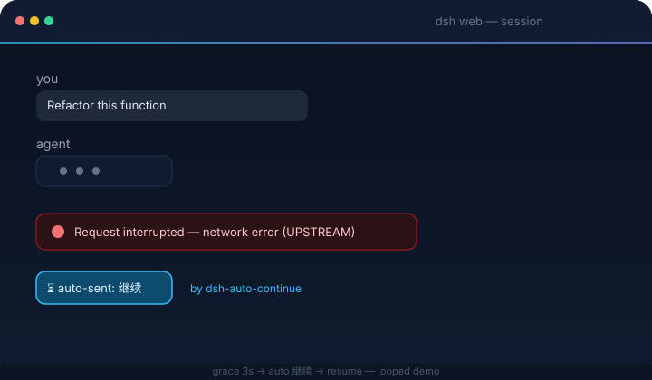

<p align="center">
  <picture>
    <source media="(prefers-color-scheme: dark)" srcset="docs/banner-dark.svg">
    
  </picture>
</p>

<p align="center">
  A <a href="https://github.com/deepseek-ai/deepseek-harness">DeepSeek Harness</a> plugin that resumes interrupted sessions for you, with an optional autonomous loop.
</p>

<p align="center">
  <a href="https://www.npmjs.com/package/dsh-client-auto-continue"></a>
  <a href="https://www.npmjs.com/package/dsh-client-auto-continue"></a>
  <a href="https://github.com/HsiangNianian/dsh-auto-continue/stargazers"></a>
  <a href="LICENSE"></a>
  <a href="https://awesome-dsh-plugin.com"></a>
  <a href="https://www.dsh.so/artifact/dsh-auto-continue/"></a>
</p>

<p align="center">
  <b>English</b> · <a href="README.zh.md">中文</a> · <a href="README.ru.md">Русский</a> · <a href="CHANGELOG.md">Changelog</a>
</p>

## Contents

- [What it does](#what-it-does)
- [Install](#install)
- [Usage](#usage)
- [Configuration](#configuration)
- [How it works](#how-it-works)
- [Troubleshooting](#troubleshooting)
- [Privacy and permissions](#privacy-and-permissions)
- [Development](#development)
- [Links](#links)
- [License](#license)

## What it does

When a turn fails with a recoverable error, hits the output limit, ends without visible output, or is cut off by a host restart, the plugin waits a few seconds and sends a continue message for you. It runs inside the DSH host, so it keeps working after you close the browser tab, and all tabs share one engine.

<p align="center">
  <picture>
    <source media="(prefers-reduced-motion: reduce)" srcset="docs/demo-static.svg">
    
  </picture>
</p>

- **Error recovery.** Network errors, timeouts, 5xx and 429 are retried with a grace period, a cooldown that grows after each failure, and a cap on consecutive attempts. Permanent errors (auth, balance, unknown model, context too long) are skipped.
- **Offline hold.** Network failures wait for the connection to come back instead of burning retries.
- **Startup recovery.** After a host restart, sessions interrupted in the last 15 minutes are resumed, including ones you have not reopened.
- **Per-session modes.** A switch next to the message box sets each conversation to Follow default, Off, Recovery only or Autonomous loop.
- **Autonomous loop (opt-in).** Keep a session going after normal completions, with an optional round limit.
- **Safety.** An idempotency guard tells the model whether the last tool call finished, and a loop guard stops turns that repeat themselves.
- **Visibility.** A settings page with today's statistics, recent recovery attempts and paused sessions, plus optional browser notifications with **Resume now** and **Pause this session 1h** buttons.

## Install

DSH plugins install into a profile; `dsh web` uses the `web` profile. In the desktop app, install from its **Plugins** page instead of the CLI.

### From npm (recommended)

```bash
dsh plugin --profile web add dsh-client-auto-continue@latest
dsh web
```

Restart DSH and reload the browser after installing. Then open **Plugins → dsh-client-auto-continue** from the main sidebar to check that it is **Running**.

To update, let running work finish, stop DSH, run the same command again, then restart DSH and reload the browser. Your settings stay in the profile. The desktop app has its own profile: update it from the app's **Plugins** page.

### Compatibility

| DSH runtime | Plugin version | Settings location |
| --- | --- | --- |
| 0.2.2-rc.1, 0.2.1-rc.2, 0.2.1-alpha.1 | 0.18.0 verified | **Plugins → dsh-client-auto-continue** |
| 0.2.0-rc.1 | 0.12.1 or newer | **Plugins → dsh-client-auto-continue** |
| 0.1.7-rc.2 | 0.11.9 or newer | **Plugins → dsh-client-auto-continue** |
| Older hosts with the legacy settings API | legacy UI | **Settings → Plugins → Plugin configuration** |

DSH 0.1.0-rc.6 and earlier are not supported. Plugin 0.11.9 and 0.12.0 are rejected by DSH 0.2.0-rc.1's version check ([#50](https://github.com/HsiangNianian/dsh-auto-continue/issues/50)). The desktop app's version is not the DSH runtime version; check the runtime (`dsh --version` for the CLI).

<details>
<summary>Install from GitHub (tracks <code>main</code>)</summary>

Built files are committed, so no clone or build is needed:

```bash
dsh plugin --profile web add github:HsiangNianian/dsh-auto-continue
dsh web
```

This follows the `main` branch rather than releases. To switch install sources, run `dsh plugin --profile web add <other-spec>`; the profile dependency is replaced in place.

</details>

<details>
<summary>Install from a local checkout</summary>

Use Node.js 22.

```bash
git clone https://github.com/HsiangNianian/dsh-auto-continue.git
cd dsh-auto-continue
npm ci
npm run build
dsh plugin --profile web add "link:$(pwd)"
dsh web
```

The package ships its own `cordis.patch.yml` (`dsh.bundle.patch`), so the plugin registers itself. After editing the code, run `npm run build`, restart DSH and reload the browser.

</details>

<details>
<summary>Migrating an older manual installation</summary>

Older setups used a symlink plus a hand-written `insert` row in the loader config. That can start the engine without showing the plugin on the **Plugins** page.

1. Let running work finish and stop `dsh web`. Back up `package.json`, `cordis.patch.yml` and `pnpm-lock.yaml` in `~/.dsh/profiles/web/`, and `~/.dsh/settings.yaml` if it exists (use `$DSH_HOME` instead of `~/.dsh` if you set it).
2. In `cordis.patch.yml`, remove only the hand-written `auto-continue` row inside an `insert` list (and the list if it becomes empty). Keep a top-level `- id: auto-continue` entry with `config:`; that is your settings.
3. Install with the npm or GitHub command above. The profile's `package.json` should now list `dsh-client-auto-continue` under `dsh.profile.bundles`.
4. If you had settings in the old `settings.yaml` `auto-continue` section, merge them into the profile's `cordis.patch.yml` entry:

   ```yaml
   - id: auto-continue
     config:
       cooldownMs: 45000 # your own saved value
   ```

5. Start `dsh web`, reload the browser, open **Plugins → dsh-client-auto-continue** and check your values.

On hosts that offer both profile config and the legacy settings API ([#64](https://github.com/HsiangNianian/dsh-auto-continue/issues/64)), the plugin imports the `auto-continue` section of `$DSH_HOME/settings-legacy.yaml` once per profile. Values already in the profile win, and the old file is left untouched. Recovery waits until the import is done; if the import fails, the host logs an error and recovery stays held until you fix the file or permissions and restart.

The `include:auto-continue` label under **Built-in plugins** is the normal loader prefix, not a sign of a duplicate install.

</details>

<details>
<summary>Verify and uninstall</summary>

```bash
# the composed config should contain exactly one auto-continue entry
dsh --profile web --dump-config | grep -A 4 'id: auto-continue'

# uninstall
dsh plugin --profile web remove dsh-client-auto-continue
```

Also remove the `- id: auto-continue` entry from the profile's `cordis.patch.yml`, if there is one, then restart DSH.

</details>

## Usage

Recovery is on by default. Nothing else needs to be set up.

### Session modes

The **Auto-continue** switch next to the message box applies to the current conversation only. The menu beside it picks a mode:

| Mode | What happens |
| --- | --- |
| Follow default | Uses **Default session mode** from the settings (Recovery only unless you change it) |
| Off | No automatic messages and no loop-guard interruptions in this conversation |
| Recovery only | Recovers errors, output limits, silent turns and restart interruptions; leaves normal completions alone |
| Autonomous loop | Also continues after every normal completion, using the loop text |

Turning the switch off selects Off; turning it on again selects Follow default. Choices are saved on the host right away (`sessionModes`), sync across tabs and survive restarts. Switching a conversation to Off cancels anything waiting to be sent but lets a running turn finish.

<p align="center">
  
</p>

In a narrow window the label and menu collapse to an icon. DS-Bot and dsh-pocket get the same compact layout up to 640 CSS pixels. To hide the controls, turn off **Show auto-continue switch in the composer** in **General** and save; this does not change any session's mode.

### Pausing and manual control

- **Enable auto-continue globally** (in **General**) is the master switch. Turning it off stops all automatic messages without forgetting per-session choices. The loop guard keeps running; turn off **Loop guard** too if you want no interruptions at all.
- **Pause this session 1h** (notification button) suspends one conversation for an hour.
- **Resume now** (notification button) sends one continue message immediately. It ignores cooldown, the consecutive limit and any pause, but does not lift the pause.
- Sending a message yourself, or a new turn starting, cancels any continue message that is still waiting.

### Status and logs

The **Status and logs** category shows today's counts (continue messages, recoveries, failures, skipped errors, give-ups, loop breaks, by error code, with a reset button), the last 20 recovery attempts grouped by session, and the sessions that are currently paused. These live in host memory and reset when the plugin restarts. With **Verbose logs** on, every decision is logged with an `[auto-continue]` prefix in the DSH log (the terminal running `dsh web` for the CLI).

## Configuration

Open **Plugins → dsh-client-auto-continue** from the main sidebar and pick a category. (**Settings → Built-in plugins** only lists component status; it is not the editor.) Edits are staged and take effect when you click **Save**; switching categories keeps your drafts, invalid values block the save, and **Reset to default** removes an override.


Settings are stored in the `auto-continue` entry of the active profile patch, `~/.dsh/profiles/web/cordis.patch.yml` for the default web profile (older hosts: `~/.dsh/settings.yaml`, under `auto-continue:`). You can edit the file directly; omitted keys use their defaults:

```yaml
- id: auto-continue
  config:
    cooldownMs: 45000
    resumeCompletedTurns: true
    loopMaxIterations: 20
```

Times are in milliseconds. Text fields left empty use the built-in text in the current language.

### General

| Setting | Key | Default | Notes |
| --- | --- | --- | --- |
| Enable auto-continue globally | `paused` | `false` | Stored inverted: `paused: true` stops all automatic messages and cancels queued ones |
| Show auto-continue switch in the composer | `showComposerToggle` | `true` | Only hides or shows the controls |
| Send continue messages with plugin source | `usePluginSource` | `false` | Off sends as the `user` source; on marks messages as `plugin:dsh-client-auto-continue` |
| Resume silent turns | `resumeSilentTurns` | `true` | Resume turns that had model activity but no visible output; they still count toward **Max consecutive** |
| Default session mode | `resumeCompletedTurns` | `false` | `false` = Recovery only, `true` = Autonomous loop, for sessions on Follow default |
| Autonomous loop round limit | `loopMaxIterations` | `0` | Loop rounds per session, `0` = no limit. Resets when you send a message or turn the loop back on |
| Browser notifications | `notify` | `false` | Notifications for sends, skips, give-ups and saved settings. The browser asks for permission the first time |

### Retry strategy

| Setting | Key | Default | Notes |
| --- | --- | --- | --- |
| Grace period (ms) | `graceMs` | `3000` | Wait before sending; a new turn or your own message cancels it |
| Cooldown (ms) | `cooldownMs` | `20000` | Minimum gap between recovery attempts in one session. A failure during cooldown waits for the rest of it |
| Max consecutive | `maxConsecutive` | `3` | Attempts before giving up. Resets when you send a message or a turn ends with visible output. Loop continuations after normal completions do not count |
| Classify errors | `classify` | `true` | Retry transient errors only; skip permanent ones. Off = retry every error |
| Custom retryable errors | `retryableErrorPatterns` | `''` | One literal per line, case-insensitive, matched against code, HTTP status and message. Overrides the built-in classifier |
| Backoff factor | `backoffFactor` | `2` | Cooldown multiplier per consecutive failure (20 s → 40 s → 80 s) |
| Max backoff (ms) | `backoffMaxMs` | `300000` | Upper bound for the cooldown |
| Pause while offline | `pauseWhenOffline` | `true` | Hold network-error retries while the host is offline, without using up attempts |
| Offline re-check interval (ms) | `offlineCheckMs` | `15000` | How often a held retry checks the network. Minimum 1000 |
| Re-arm goals disarmed by a restart | `resumeGoals` | `false` | After a continue message, re-arm an `active` goal the restart disarmed. This acts on your behalf, hence off |
| Resume paused goals | `resumePausedGoals` | `false` | Also resume goals you paused by hand. Needs `resumeGoals` |

### Startup recovery

| Setting | Key | Default | Notes |
| --- | --- | --- | --- |
| Scan on host startup | `scanOnBoot` | `true` | Look for interrupted sessions, open or stored, after the host starts |
| Wake child sessions after restart | `resumeInterruptedChildren` | `false` | Send each root session one message listing its interrupted subagent or team-member sessions |
| Scan limit | `scanLimit` | `8` | Recoveries per scan pass, most recently active first |
| Scan window (ms) | `freshMs` | `900000` | Only interruptions newer than this are recovered; scanning also stops after this long |

### Continue text

| Setting | Key | Used when |
| --- | --- | --- |
| Continue text | `continueText` | A turn failed with an error |
| Continue text (max tokens) | `continueTextMaxTokens` | The output token limit was reached |
| Continue text (silent turn) | `continueTextSilent` | A turn ended with reasoning only |
| Continue text (after harness restart) | `continueTextInterrupted` | The startup scan resumes a turn a restart cut off |
| Continue text (autonomous loop) | `continueTextLoop` | Each autonomous-loop round |
| Guard text (unconfirmed result) | `guardPendingText` | Appended when the last tool call may not have finished |
| Guard text (tool succeeded) | `guardDoneText` | Appended when the last tool call succeeded |
| Loop text | `loopText` | The loop guard restarted a turn |

All default to `''`, which means the built-in text. Continue texts accept `{code}`, `{message}`, `{status}`, `{tool}`, `{turn}`, `{errorCount}` and `{elapsed}`; for example `Continue ({tool}: {code})` becomes `Continue (git push: UPSTREAM)`. Guard texts and the loop text accept `{tool}`, and `guardDoneText` also `{result}` (a short excerpt of the tool output).

Built-in texts exist in English and Chinese. They follow the DSH language: `zh` and `zh-*` use Chinese, every other locale uses English. Your own non-empty text is never replaced when the language changes.

<details>
<summary>Built-in English texts</summary>

| Key | Text |
| --- | --- |
| `continueText`, `continueTextMaxTokens`, `continueTextLoop` | `Continue` |
| `continueTextSilent` | `Continue. Your previous turn ended with internal reasoning only, with no message and no tool call, so nothing reached the user. Always finish a turn with a tool call or a visible answer.` |
| `continueTextInterrupted` | `Continue. The harness was restarted while your previous turn was still running; tool calls pending at the restart are recorded with unknown outcomes. Resume where you left off, verifying external state before retrying anything that may have side effects.` |
| `guardPendingText` | `(The previous tool "{tool}" may not have completed. Check its state before continuing and do not run it again.)` |
| `guardDoneText` | `(The previous tool "{tool}" completed successfully. Result: {result}; do not run it again. Continue from there.)` |
| `loopText` | `(You may be stuck in a loop. Stop repeating the last action and continue with a different approach.)` |

</details>

### Safety

| Setting | Key | Default | Notes |
| --- | --- | --- | --- |
| Idempotency guard | `guardTools` | `true` | Before resuming, tell the model whether the last tool call finished so it does not run it twice |
| Loop guard | `loopGuard` | `true` | Cancel a running turn that repeats itself and restart it with the loop text |
| Short-sentence max (chars) | `loopShortChars` | `40` | Messages shorter than this count as short sentences |
| Short-sentence window (ms) | `loopWindowMs` | `30000` | Window for counting short sentences. Minimum 1000 |
| Short-sentence threshold | `loopShortCount` | `12` | Short sentences in the window, with no tool call, that trip the guard |
| Identical message count | `loopRepeatText` | `4` | Identical messages in a row (or repeated paragraphs within one streamed message) that trip the guard |
| Same-tool repeat count | `loopToolRepeat` | `5` | Calls of the same tool with identical arguments and results that trip the guard |

### Status and logs

| Setting | Key | Default | Notes |
| --- | --- | --- | --- |
| Verbose logs | `verbose` | `true` | Log decisions with the `[auto-continue]` prefix |

Two keys are written by the plugin itself: `locale` (mirrors the DSH language, default `en`) and `sessionModes` (per-session choices from the composer, default `{}`). You normally do not edit them.

### Error classification

With **Classify errors** on, network errors, timeouts, HTTP 5xx and 429 are retried. HTTP 401 and 403, and codes or messages about auth, credentials or API keys, balance or quota, unknown models, or context length are treated as permanent and skipped (with a notification if enabled). `MALFORMED_RESPONSE` is always retryable unless it carries an explicit 401 or 403.

If a provider returns an error that you know is safe to retry (check first that typing "continue" by hand works), add a narrow, stable fragment instead of turning classification off:

```yaml
- id: auto-continue
  config:
    retryableErrorPatterns: |-
      Upstream rejected the request as invalid
```

Patterns are plain substrings, not regular expressions. Cooldown and **Max consecutive** still apply.

## How it works

[](docs/auto-continue-workflow.en.html)

1. **Triggers.** The engine listens to session events in the host. A `turn/end` with `error`, `max-tokens`, a silent ending, or `completed` (loop mode only) starts the flow. After a host restart, the startup scan checks open and stored sessions every 3 seconds until the scan window ends. The loop guard watches running turns and cancels one that repeats itself.
2. **Session check.** Nothing is sent while auto-continue is paused globally, the session is Off or paused for an hour, or the session is a subagent. Subagents stay under their parent's control.
3. **End reason.** Manual Stop and policy blocks (`blocked`) are left alone, and so are permanent errors. Everything else recoverable goes to recovery. A normal completion only continues in Autonomous loop mode, which skips the cooldown and the consecutive limit but respects `loopMaxIterations`.
4. **Retry budget.** Recovery stops at **Max consecutive**. Inside the cooldown, the send is deferred rather than dropped. The cooldown is multiplied by the backoff factor after each failure, up to the maximum.
5. **Grace period.** The engine waits `graceMs`. A new turn or a message from you cancels the send.
6. **Offline hold.** For network errors, the host checks for a non-loopback network interface and one resolvable public name. While offline it waits and re-checks every `offlineCheckMs`, then goes through grace and cooldown again. With `HTTP(S)_PROXY` or `ALL_PROXY` set, only interfaces are checked.
7. **Send.** The engine picks the text for the reason, appends the idempotency-guard note, and sends it with `agent.followup` using the session's preset and model. If user turns are already queued, the continue message is moved ahead of them while their order is kept. With `resumeGoals` on, a goal the restart disarmed is re-armed.

**Child sessions.** Subagent and team-member sessions are never resumed directly. With **Wake child sessions after restart** on, the startup scan collects children a restart interrupted (at most 8 child logs per pass) and sends their root session one message listing them, once per batch. The root decides whether to continue or wrap up. A root still mid-turn is left to normal recovery, and a root you stopped yourself is never woken.

**Unreadable sessions.** If a session's history cannot be read during the startup scan, that session is skipped and an error is logged; other sessions still recover ([#58](https://github.com/HsiangNianian/dsh-auto-continue/issues/58)). Repair it and restart DSH within the scan window to try again.

## Troubleshooting

| Symptom | What to check |
| --- | --- |
| "Skipping profile bundle" or "incompatible with dsh 0.2.0-rc.1" | Update to plugin 0.12.1 or newer in the profile the app actually uses, then restart |
| Plugin enabled, but no settings fields | Open the main **Plugins** page, not **Settings → Built-in plugins**, and select **General** |
| `/api/auto-continue-bridge` returns 404 | The host component did not load. Check the DSH startup log and `--dump-config`, then reload the page |
| An error was not resumed | Check the global switch and the session mode. Look for `[auto-continue]` log lines: they say whether the error was classified as permanent, the session hit **Max consecutive**, or the retry is held offline |
| Sessions not resumed after a restart | **Scan on host startup** must be on, and the interruption must be newer than the scan window (15 minutes by default) |
| Settings are ignored after migrating | Make sure there is one top-level `- id: auto-continue` entry in `cordis.patch.yml` and no leftover `insert` row; see the migration notes under [Install](#install) |
| Compact composer layout missing on a phone | Restart DSH and reload the remote page after updating the plugin |

## Privacy and permissions

- The engine runs in the DSH host and reads session events and history through DSH services. No third-party service is contacted and no credentials are stored.
- Continue messages go through `agent.followup`; the loop guard may call `agent.cancel` first. A resumed agent keeps the session's existing tools and permissions.
- The offline check reads the local network interfaces and does a DNS lookup of `api.deepseek.com`, `www.baidu.com` and `one.one.one.one`. It opens no connection and sends no request.
- Settings are saved through DSH's settings API to the active profile (or `~/.dsh/settings.yaml` on older hosts). Retry counters, cooldowns, one-hour pauses and statistics are kept in memory only.
- Browser notifications are opt-in. Permission is requested only when you turn them on and save.

## Development

Use Node.js 22.

```bash
npm ci
npm run typecheck
npm run build
npm test
```

`npm run test:runtime` runs the settings, startup-recovery and restart tests against published DSH packages. Install the pinned fixtures first:

```bash
for v in 0.1.7 0.2.0 0.2.0-rc.2 0.2.1 0.2.1-rc.2; do npm ci --prefix "tests/fixtures/dsh-$v"; done
npm run test:runtime
```

The runtime tests drive real DSH services with a deterministic model adapter; they make no requests to a model provider. CI also checks that the committed `lib/` matches a fresh build and runs [dsh-plugin-check](https://github.com/omdsh-dev/dsh-plugin-check).

The banners and social preview are generated by `npm run docs:assets`; the workflow map is an [Archify](https://github.com/tt-a1i/archify) export (`docs/auto-continue-workflow.*`, sources in `*.archify.json`) (render the PNG with `rsvg-convert -w 1280 -h 640 docs/social-preview.svg -o docs/social-preview.png`). See [docs/screenshots/README.md](docs/screenshots/README.md) for how the screenshots are captured.

## Links

- Repository: [github.com/HsiangNianian/dsh-auto-continue](https://github.com/HsiangNianian/dsh-auto-continue)
- npm: [dsh-client-auto-continue](https://www.npmjs.com/package/dsh-client-auto-continue)
- DeepSeek Harness: [github.com/deepseek-ai/deepseek-harness](https://github.com/deepseek-ai/deepseek-harness)
- dsh-plugin-check: [github.com/omdsh-dev/dsh-plugin-check](https://github.com/omdsh-dev/dsh-plugin-check)
- LINUX DO: [linux.do](https://linux.do)

[](https://gitstock.org/HsiangNianian/dsh-auto-continue)

## License

[MIT](LICENSE) © Hsiang Nianian
