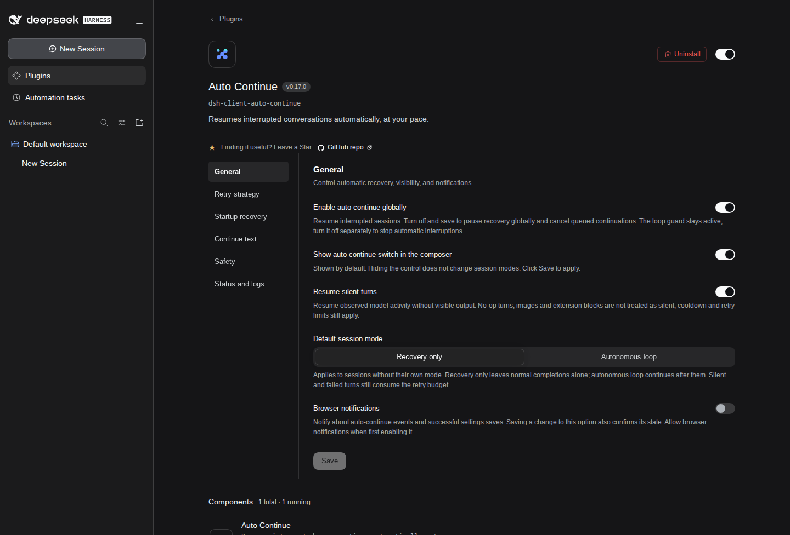
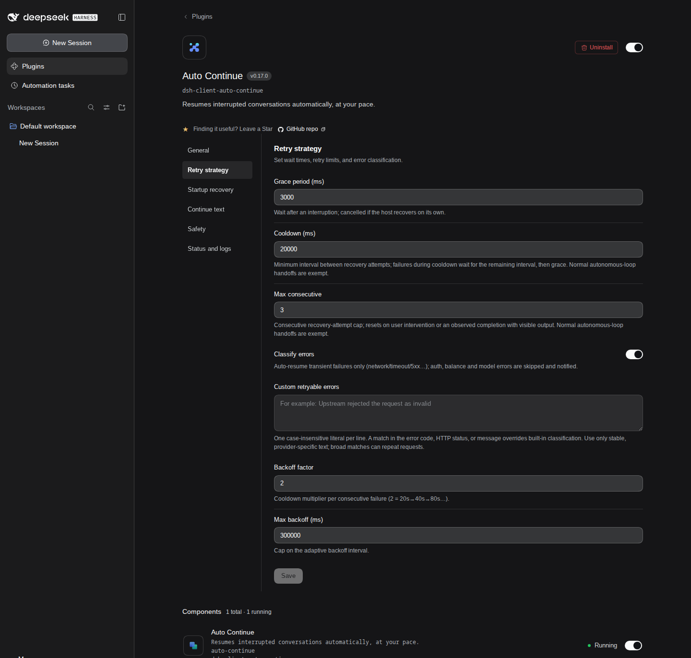
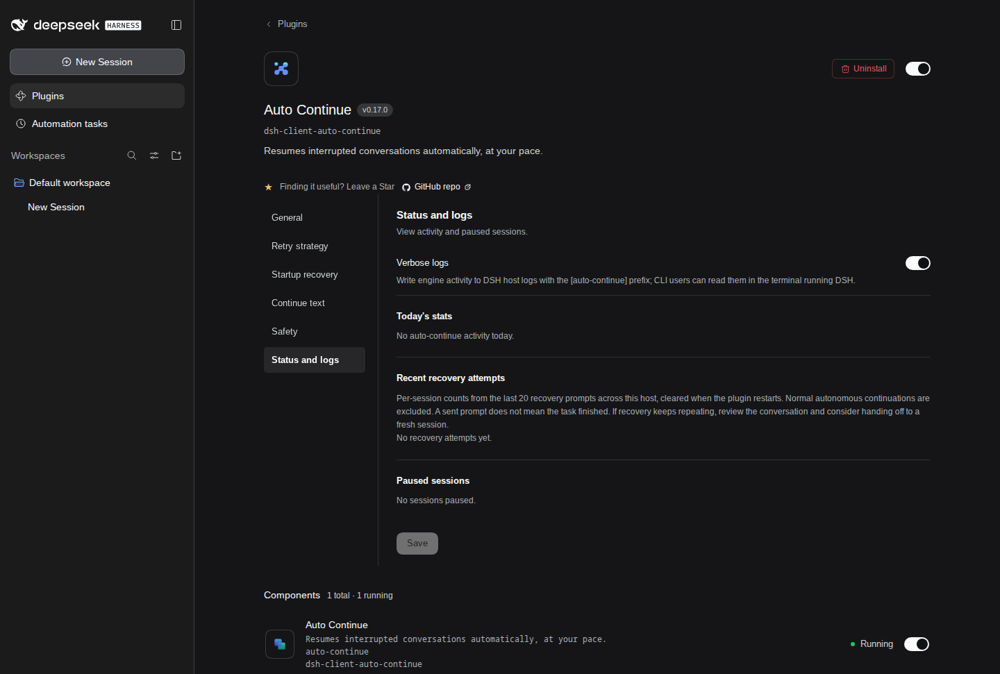

<p align="center">
  <picture>
    <source media="(prefers-color-scheme: dark)" srcset="docs/banner-dark.svg">
    
  </picture>
</p>

<h1 align="center">dsh-auto-continue</h1>

<p align="center">
  <em>Recover interrupted DSH sessions automatically, with an optional loop to continue after successful turns.</em>
</p>

<p align="center">
  <a href="https://www.npmjs.com/package/dsh-client-auto-continue"></a>
  <a href="https://www.npmjs.com/package/dsh-client-auto-continue"></a>
  <a href="https://github.com/HsiangNianian/dsh-auto-continue/stargazers"></a>
  <a href="https://github.com/HsiangNianian/dsh-auto-continue/blob/main/LICENSE"></a>
  <br>
  <a href="https://awesome-dsh-plugin.com"></a>
  <a href="https://www.dsh.so/artifact/dsh-auto-continue/"></a>
  <br>
  
  
  
</p>

<p align="center">
  <b>English</b> · <a href="README.zh.md">中文</a> · <a href="CHANGELOG.md">Changelog</a>
</p>

---

## What It Does

Automatic recovery for [DeepSeek Harness](https://github.com/deepseek-ai/deepseek-harness), in the Web UI and desktop app. When a recoverable failure interrupts a session, the plugin sends your configured continuation prompt through DSH. The engine runs **inside the host process**, so it keeps watching while browser tabs are closed; all tabs share that engine. Recovery is enabled by default. Continuing after successful turns is a separate, **opt-in autonomous loop**.

<p align="center">
  <picture>
    <source media="(prefers-reduced-motion: reduce)" srcset="docs/demo-static.svg">
    
  </picture>
</p>

**Smart recovery** (all configurable):

- **Session modes** — switch auto-continue on or off beside the message input, for that conversation only. The mode menu next to the switch shows the current mode and opens Follow default, Off, Recovery only or Autonomous loop. Choices save on the host, survive restarts and sync across tabs; hiding the control does not change them
- **Error classification** — transient failures (network / timeout / 5xx / 429…) are auto-resumed; errors classified as permanent are **skipped** and notified. This includes HTTP 401/403 or, except for `MALFORMED_RESPONSE`, codes/messages matching auth, credential/API-key, balance/quota, unknown-model, or context-length/overflow keywords. Use literal custom retryable patterns for provider-specific exceptions; turning classification off allows recovery attempts for all errors
- **Adaptive backoff** — consecutive failures wait longer each time (cooldown × factor: 20s → 40s → 80s…), up to the configured maximum
- **Offline hold** — on by default (`pauseWhenOffline`). Before retrying a network failure (`TRANSPORT`, `TIMEOUT`, DNS or connection errors), the host checks it is online: a non-loopback network interface plus one resolvable public name. While offline the retry waits and re-checks every `offlineCheckMs` (15s) without using up **Max consecutive**, then goes through the normal grace period and cooldown once the network is back. Server errors (5xx, 429) are not held. With `HTTP(S)_PROXY` / `ALL_PROXY` set, only interfaces are checked, since local DNS may not work behind such a proxy
- **English / Chinese localization** — the settings card uses DSH's locale service. Built-in resume / guard / loop text and browser notifications use Chinese for `zh` and `zh-*` (case-insensitive), and English for every other or unset locale. Switching languages updates built-in defaults without overwriting custom text
- **Templated continue text** — `continueText` supports `{code}` `{message}` `{status}` `{tool}` `{turn}` `{errorCount}` `{elapsed}` placeholders, so the resume message can carry the failure context ("Continue ({tool} failed: {code})"); a **separate template** fires on `max-tokens` (e.g. "Continue the output without repeating anything already generated")
- **Idempotency guard** — before resuming, the plugin checks the last tool call and asks the model to verify an unconfirmed result (such as a `git push` interrupted mid-call) without rerunning the tool, or to continue without repeating a successful call. Failed calls receive no extra guard text. Both texts are configurable (`{tool}` / `{result}` placeholders)
- **Silent turn resume** — recover a normally completed turn with observed model activity but no visible output. Text, tool calls, images, extension blocks and streamed output count as visible. Turns without observed model activity are excluded unless they have an explicit `no-visible-output` ending, which can also recover after restart. Disabling **Resume silent turns** cancels queued silent sends. Silent turns do not reset the consecutive-attempt count, whether this option is on or off.
- **Autonomous loop** — off by default (`resumeCompletedTurns`). When enabled, normally completed turns continue after the grace period, without the recovery cooldown or attempt cap. Reasoning-only turns and explicit `no-visible-output` endings still consume the recovery budget and obey backoff. Global pause, a session pause, manual Stop or changing that session to Recovery only / Off stops the loop. The profile default only affects sessions using Follow default. Its prompt is separate from the loop guard’s prompt (`continueTextLoop`, default `Continue`). `loopMaxIterations` caps the rounds per session (0 = unlimited, the default): once reached, the loop stops and reports it once (log line, plus a notification when notifications are on). Sending a message yourself or turning the loop back on starts the count over
- **Pause** — turning off **Enable auto-continue globally** in **General** and saving stops automatic sends from live events and startup scanning; per-session pauses (e.g. via a notification button) suspend only one session until they expire. **Resume now** requests one send even when both pauses are active. It leaves the pauses in place, so later automatic recovery and autonomous-loop sends remain paused
- **Notification buttons** — notifications carry **Resume now** (send immediately, ignoring cooldown, the consecutive cap and any pause) and **Pause this session 1h** actions
- **Child-session hand-off** — opt-in (`resumeInterruptedChildren`, off by default): when the startup scan finds subagent or team-member sessions that a restart interrupted, the plugin sends each **root session** one message listing those children, once per batch. The child itself is still never resumed — the root decides whether to continue each task or wrap it up. A wake only goes to a parent whose own last turn ended cleanly or was closed by that same restart; a parent still mid-turn is left to the normal recovery path, and one you stopped yourself is never woken
- **Goal re-arm** — opt-in (`resumeGoals`, off by default): after any auto-continue send (or a child-session wake-up), re-arm an `active` goal that the host disarmed on restart, so its continuation rounds can run again. **Resume paused goals** (`resumePausedGoals`) additionally resumes goals you paused by hand, and only takes effect when `resumeGoals` is on as well
- **Loop guard** — cancels a **running** turn and restarts it with configurable loop text when it repeats identical messages (of any length), near-duplicate paragraphs within one streamed assistant message, many short messages within a time window without tool calls, or the same tool with **identical arguments and results**. Changed tool arguments or results count as progress. Manual Stop does not trigger a guard restart. Thresholds, the time window and the loop text are configurable
- **Stats panel** — the settings card shows today's auto-continue count, recoveries, failures, permanent skips, give-ups and loop breaks, broken down by error code, with a one-click reset
- **Browser notifications** — optional alerts for auto-continue events and successful settings saves. Saving a change to the notification switch confirms its new state, including one final confirmation when turning it off. The browser may ask for permission when you enable it; a denial is explained in the settings page and does not prevent saving.

It watches the live event streams and reacts to:

| Event | Meaning |
| --- | --- |
| `turn/end` → `error` | Turn failed (model / network / timeout, …) |
| `turn/end` → `interrupted` | Crash-orphaned turn left behind by a host restart (recovered by the startup scan) |
| `turn/end` → `max-tokens` | Output token ceiling reached |
| `turn/end` → `completed` / `no-visible-output` with no visible output | Observed model activity without visible output, or an explicit silent-ending marker |
| `turn/end` → `completed` | Continue a normal completion only when autonomous loop is enabled |

What each kind of turn gets, and which switch gates it:

| Scenario | Auto-continues? | Trigger path | Gated by |
| --- | --- | --- | --- |
| This session's turn failed, hit the output ceiling, or was closed by a host restart | Yes — one followup message in the same session | Live event, or the startup scan after a restart | **Enable auto-continue globally**, the session mode, **Scan on host startup** (`scanOnBoot`) |
| This session's turn ended with no visible output | Yes | Live event, or the startup scan | **Resume silent turns** (`resumeSilentTurns`) |
| This session's turn completed normally | Only in **Autonomous loop** | `turn/end` → `completed` | `resumeCompletedTurns` / the session mode |
| A subagent or team-member session was interrupted by a restart | **No** — the child session is never resumed directly | Startup scan collects the list, then sends **one wake-up message to its root session** | `resumeInterruptedChildren` (off by default) |
| The session carries an `active` goal that the restart disarmed | Not by itself: the resumed turn needs the goal armed again | After any auto-continue send for that session | `resumeGoals` (off by default) |
| The session carries a goal you paused by hand | Only if you opt in | Same path | `resumeGoals` **and** `resumePausedGoals` (both off by default) |

**Recovery stops for:** manual Stop, policy rejection (`blocked`), paused sessions, subagent sessions and the consecutive-attempt cap. A new turn or manual user message cancels a queued continuation. Live `interrupted` markers are left to the startup recovery scan. Recoverable failures during cooldown are **deferred**, not discarded. When an interrupted session already has queued turns, the plugin tries to prioritize the continuation while preserving the order of the user turns. The loop guard can separately cancel and restart a running turn that is repeating itself.

Subagent sessions stay under their parent agent's control. The plugin skips them during live recovery and startup scanning, ignores **Resume now** for them, and leaves them out of loop-guard cancellation. Any queued recovery is cancelled when a session is identified as a subagent. The optional **Wake child sessions after restart** (`resumeInterruptedChildren`, off by default) does not change that: the plugin still never resumes a child, it only tells the child's root session which children a restart interrupted, so the root can continue them or wrap them up.

---

## How It Works

Recovery runs in the DSH host and is shared across browser tabs. After an interruption, it waits a **grace period** (default 3 s), then sends the configured text. A new turn (`turn/start`) cancels the pending send. Continue messages normally run before queued user turns. If queue reordering fails, the continue message stays behind those turns; queued user turns keep their original order.

At startup, the plugin also checks saved sessions, including conversations you have not reopened. It recovers eligible interruptions **within the scan window** (default 15 minutes) when no later `turn/start` or user message exists. Recovery uses the session's preset and recorded model, including when a host restart interrupted a running turn.

If a session's history cannot be read or contains invalid events, the current startup scan skips it and logs an error; other eligible sessions can still recover. After repairing the session history, restart DSH to scan it again; the interruption must still fall within the scan window. Empty or still-loading sessions are checked again during that window. See [#58](https://github.com/HsiangNianian/dsh-auto-continue/issues/58).

Use the browser to configure recovery, choose session modes, view statistics and paused sessions, and receive optional notifications with **Resume now** / **Pause this session 1h** actions.

### Recovery workflow

The diagram summarizes the automatic recovery path, the loop-guard restart path, and the exit to human intervention. Click it to open the full-size version.

[](docs/auto-continue-workflow.en.svg)

## Quick Start

DSH plugins install into a **profile** (`dsh web` → `web` profile). The commands below install into the web profile; restart `dsh web` after installation. In the desktop app, install through its **Plugins** page instead.

### Compatibility

| DSH runtime | Plugin version | Configuration entry point |
| --- | --- | --- |
| **0.2.2-rc.1** | **0.18.0 verified** | **Plugins → dsh-client-auto-continue** |
| **0.2.1-rc.2** | **0.18.0 verified** | **Plugins → dsh-client-auto-continue** |
| **0.2.1-alpha.1** | **0.18.0 verified** | **Plugins → dsh-client-auto-continue** |
| **0.2.0-rc.1** | **0.12.1 or newer** | **Plugins → dsh-client-auto-continue** |
| **0.1.7-rc.2** | **0.11.9 or newer** | Same Plugins page |
| Older hosts with the legacy settings API | Legacy UI retained | **Settings → Plugins → Plugin configuration** |

DSH 0.1.0-rc.6 and earlier are unsupported. Automated settings and compatibility checks cover **0.1.7-rc.2**, **0.2.0-rc.1**, **0.2.1-alpha.1** and **0.2.1-rc.2**; startup recovery checks also cover **0.2.0-rc.2** and **0.2.1-alpha.1**. Desktop app versions and embedded DSH runtime versions are different; use the runtime version when checking compatibility. For the CLI, run `dsh --version`; see [official DSH releases](https://github.com/deepseek-ai/deepseek-harness/releases) for available versions.

**Plugins 0.11.9 and 0.12.0 are rejected by DSH 0.2.0-rc.1’s version check.** Upgrade the plugin to 0.12.1 or newer; its existing configuration-form integration works on this runtime. See [#50](https://github.com/HsiangNianian/dsh-auto-continue/issues/50).

On current DSH, **Settings → Built-in plugins** is a component inventory, not the configuration editor. Use the main **Plugins** page. The screenshots below show plugin **0.14.0** on **DSH 0.2.1-alpha.1**. If you previously installed with a symlink or hand-written loader entry, see [Migrating an older installation](#migrating-an-older-installation).

### From npm (recommended)

Published as [`dsh-client-auto-continue`](https://www.npmjs.com/package/dsh-client-auto-continue):

```bash
dsh plugin --profile web add dsh-client-auto-continue@latest
dsh web
```

### Updating an installed plugin

Let active work finish and stop DSH. Run the npm command above again to replace the installed version with `@latest`, then restart DSH and reload the browser. Existing configuration overrides remain in the profile. For a desktop installation, update the plugin from that app’s **Plugins** page and restart the app; updating the CLI’s `web` profile does not update the desktop profile.

### Directly from GitHub (no clone needed)

Installs straight from the repository's default branch — built artifacts are committed, so no local clone or build step:

```bash
dsh plugin --profile web add github:HsiangNianian/dsh-auto-continue
dsh web
```

> This tracks the `main` branch rather than released tags — great for trying the latest changes, while the npm method above is the stable choice. Switching between install sources is just re-running `dsh plugin --profile web add <other-spec>`; the profile dependency is replaced in place.

### From this repository

Use Node.js 22, the version used by CI.

```bash
git clone https://github.com/HsiangNianian/dsh-auto-continue.git
cd dsh-auto-continue
npm ci
npm run build

# the package carries its own cordis.patch.yml (dsh.bundle.patch),
# so the plugin row registers itself
dsh plugin --profile web add "link:$(pwd)"

dsh web
```

### Migrating an older installation

A manual loader entry can start the engine without registering a bundle in the **Plugins** page. Use the profile's package manager to install the bundle; a symlink and `insert` entry alone are no longer the recommended setup.

1. Let active work finish, then stop `dsh web`. Back up `package.json`, `cordis.patch.yml` and `pnpm-lock.yaml` in `~/.dsh/profiles/web/`, plus `~/.dsh/settings.yaml` if it exists. If you set `DSH_HOME`, use that directory instead of `~/.dsh`.
2. Keep your existing auto-continue values. Remove only the manually added `auto-continue` row **inside an `insert` list** (and the list if it becomes empty). The installed bundle supplies that row. A top-level `- id: auto-continue` with `config:` is a configuration override: **keep it**.
3. Install with either the npm or GitHub command above. In the profile's `package.json`, `dsh.profile.bundles` should now include `dsh-client-auto-continue`, alongside the existing DSH bundles. If it already does and the plugin appears in **Plugins**, this part is already complete.
4. On DSH 0.1.7 / 0.2, merge any saved values from the old `settings.yaml` → `auto-continue` section or the removed row's `config` into the profile's `cordis.patch.yml`. For example, a custom cooldown becomes:

   ```yaml
   - id: auto-continue
     config:
       cooldownMs: 45000 # example: preserve your own saved value
   ```

   Merge into an existing override instead of adding another one. Keep unrelated settings intact. DSH 0.1.7 / 0.2 reads this entry config; editing the old `settings.yaml` section will not update the new form.
5. Start `dsh web` again and reload the browser. Open **Plugins → dsh-client-auto-continue**, select the appropriate settings category, and check that your values are present. Save a change and reload to confirm it persists.

The `include:auto-continue` label in **Built-in plugins** is a normal loader prefix. It does not, by itself, indicate a legacy install or a duplicate engine.

For hosts that expose both modern profile config and the legacy settings API ([#64](https://github.com/HsiangNianian/dsh-auto-continue/issues/64)), the plugin uses profile config. It imports the `auto-continue` section of `$DSH_HOME/settings-legacy.yaml` once per profile, including the saved pause and custom prompts. Existing profile values take precedence. The original file and other plugins' sections stay untouched. Resetting the configuration does not import the old values again after a restart.

Recovery and the loop guard wait while this import is pending. If the legacy file cannot be read or validated, or the profile cannot be saved, the host logs an import error and keeps both held. Repair the file or profile permissions and restart the host. Hosts that only support the legacy API continue using their existing settings store.

### Verify & uninstall

```bash
dsh --profile web --dump-config | grep -A 4 'id: auto-continue'
```

The composed config should contain one `id: auto-continue` entry. In **Plugins → dsh-client-auto-continue**, check that the component is **Running** and that the **General** category shows editable fields. With verbose logging enabled, engine activity appears in the terminal running DSH.

```bash
dsh plugin --profile web remove dsh-client-auto-continue   # npm / repo install
# also remove this plugin's config override from cordis.patch.yml, if present
dsh web
```

---

## Troubleshooting

- **“Skipping profile bundle” / “incompatible with dsh 0.2.0-rc.1”:** update to plugin 0.12.1 or newer in the profile the app actually uses, then restart it. A version exemption is not needed for this fix.
- **Enabled, but no configuration fields:** open the main **Plugins** page, select the package and open **General**. The Built-in plugins status page has no editable fields.
- **`/api/auto-continue-bridge` returns 404:** check the DSH startup log and composed config. Ensure the host component is installed and loaded, then refresh the settings page.

---

## Session modes

The **Auto-continue** switch beside the input applies only to the current conversation and saves immediately

Turning it off selects Off, and turning it back on selects Follow default
Use the mode menu next to the switch to choose a mode:

| Mode | Behavior |
| --- | --- |
| Follow default | Use **Default session mode** from the plugin settings, initially Recovery only |
| Off | No automatic followups or loop-guard interruptions in this conversation |
| Recovery only | Recover eligible failures and silent turns; leave normal completions alone |
| Autonomous loop | Also continue normally completed turns, using the loop prompt |

For example, keep A looping, B recovering failures and C off. Each conversation's choice is saved in the host's profile settings (`sessionModes`), shared across tabs and retained after a host restart. Choosing Follow default explicitly removes that conversation's independent policy, including an inherited override.

**Enable auto-continue globally** in **General** remains the master control. Turning it off pauses all automatic followups without replacing individual choices; turning it back on restores those choices. Switching a conversation off cancels pending grace, cooldown and loop-guard retries. It leaves any current turn running. Switching Loop to Recovery only cancels pending autonomous followups. Re-enabling does not resurrect cancelled sends.

The notification's **Pause this session 1h** still temporarily suspends one conversation. **Resume now** requests a single send even while paused or Off, without changing the stored mode. The global loop-guard setting remains independent of global pause, but a conversation set to Off is excluded from the guard too.

To hide the controls, open **Plugins → dsh-client-auto-continue → General**, turn off **Show auto-continue switch in the composer**, then **Save**. This only changes visibility (`showComposerToggle`, default `true`). Hosts without composer controls can still use the settings card. Failed saves appear as DSH notifications; a host that stays unavailable for three seconds shows one warning. The switch and mode menu stay disabled when the host is disconnected or settings are not writable. In a narrow composer, the label and mode menu collapse to an icon and arrow, keeping the controls on one line.

DS-Bot / dsh-pocket also use this compact layout on screens up to **640 CSS pixels**, with pause/error text below. After updating the plugin, restart DSH and reload the remote page to load the new styles.

## Configuration

On **DSH 0.1.7 / 0.2**, open **Plugins** from the main sidebar, choose **dsh-client-auto-continue**, then select a settings category. This is separate from **Settings → Built-in plugins**, which only lists component status. Older DSH versions use **Settings → Plugins → Plugin configuration**.



Use **General**, **Retry strategy**, **Startup recovery**, **Continue text**, **Safety**, and **Status and logs** to find controls. Switching categories preserves unsaved changes. **Status and logs** contains today's activity, recent recovery attempts and paused sessions.

**Recent recovery attempts** groups the last 20 recovery prompts across the host by session, showing each session's count in that window, latest cause, time and consecutive count at the last send. It works with browser notifications off. Causes distinguish silent output, output limits, request errors, restart interruptions, loop-guard recovery and manual resume. Normal autonomous continuations are excluded. The history contains no message text and resets when the plugin restarts.

The settings card shows a GitHub invitation and category navigation. The plugin manager shows the plugin name, version and enabled state. Edits take effect when you click **Save**.

With **Browser notifications** enabled, each successful save sends one confirmation from the tab where you saved. Turning notifications off sends a final confirmation if browser permission is already granted; later saves stay quiet. If the browser blocks notifications, the settings page still confirms the save and explains the permission issue.

DSH 0.1.7 / 0.2 stores these values in the `auto-continue` entry's config in the active profile patch (`~/.dsh/profiles/web/cordis.patch.yml` for the default web profile). **Save** applies changes live without restarting the engine. Omitted fields use the defaults below.

Startup recovery checks every three seconds for sessions that load late, until `freshMs` after the engine starts. Each ready session history is checked once. `scanLimit` limits eligible recoveries per pass; sessions that do not need recovery do not count toward it. Pausing suspends recovery but does not extend the window. Stopping the plugin ends the scan.

Built-in text follows DSH's language through `locale`: `zh` and `zh-*` (case-insensitive) use Chinese and are saved as `zh`; every other or unset locale uses English (`en`). Older values such as `ru` also use English. After updating the plugin, restart DSH and refresh all tabs to synchronize the saved language. Leave localized text fields empty or omit them to follow the language automatically; non-empty values are custom templates and stay unchanged when the language changes:

```yaml
- id: auto-continue
  config:
    locale: 'en' # normally managed by the browser
    paused: false
    showComposerToggle: true
    usePluginSource: false
    continueText: ''
    resumeSilentTurns: true
    resumeCompletedTurns: false
    resumeInterruptedChildren: false # Startup recovery: wake the root session about interrupted children
    resumeGoals: false # Retry strategy: re-arm a goal the host disarmed on restart
    resumePausedGoals: false # Retry strategy: also resume goals paused by hand (needs resumeGoals)
    pauseWhenOffline: true # Retry strategy: hold network-error retries while the host is offline
    offlineCheckMs: 15000
    loopMaxIterations: 0 # Autonomous loop rounds per session; 0 = unlimited
    continueTextSilent: ''
    continueTextLoop: ''
    continueTextInterrupted: ''
    continueTextMaxTokens: ''
    guardTools: true
    guardPendingText: ''
    guardDoneText: ''
    graceMs: 3000
    cooldownMs: 20000
    maxConsecutive: 3
    scanOnBoot: true
    scanLimit: 8
    freshMs: 900000
    verbose: true
    classify: true
    retryableErrorPatterns: ''
    backoffFactor: 2
    backoffMaxMs: 300000
    notify: false
    loopGuard: true
    loopShortChars: 40
    loopWindowMs: 30000
    loopShortCount: 12
    loopRepeatText: 4
    loopToolRepeat: 5
    loopText: ''
```

<details>
<summary>Configuration files on older DSH versions</summary>

Older hosts store user settings in `~/.dsh/settings.yaml` under the plugin namespace instead of a profile entry:

```yaml
auto-continue:
  cooldownMs: 45000
```

When migrating from the legacy settings file to DSH 0.1.7 / 0.2, move these values into the profile entry's `config` as described in [Migrating an older installation](#migrating-an-older-installation).

</details>

**How the card works:**



- Edits are **staged** — nothing reaches the disk until you hit **Save**; leaving the page drops unsaved drafts
- If you edit or reset a field while a save is in progress, the newer draft stays in the card. Click **Save** again after the current save finishes to apply it
- An overridden field shows a **Reset to default** button that removes the override and restores the inherited value (normally the built-in default)
- Boolean fields use native switches and are staged until Save. **Reset to default** removes the override and restores the inherited value. **Enable auto-continue globally** is on when recovery is enabled (`paused: false`)
- Invalid drafts (non-numbers, values below the minimum) block the save and mark their category, even when another category is selected
- In a read-only deployment the card shows the stored values but disables editing while keeping category navigation available
- Changes apply immediately after Save and persist in the active profile config (or `~/.dsh/settings.yaml` on older hosts)

<details>
<summary>Live status and the native Save button</summary>



</details>

| Field | Default | Description |
| --- | --- | --- |
| Pause auto-continue | `off` | Global pause: no live or scan auto-send fires, queued pending sends are cancelled |
| Show auto-continue switch in the composer | `on` | Show the session switch and mode menu (`showComposerToggle`); hiding them does not change modes |
| Send continue messages with plugin source | `off` | `usePluginSource`: off keeps the legacy `user` source; on uses `plugin:dsh-client-auto-continue` |
| Continue text | `Continue` | Text automatically sent after an interruption |
| Continue text (max tokens) | `Continue` | Text sent when the output token ceiling is reached (same placeholders) |
| Resume silent turns | `on` | Resume a turn that ended normally with reasoning only (no text, no tool call); does not reset the consecutive count |
| Continue text (silent turn) | `Continue. Your previous turn ended with internal reasoning only, ...` | Text sent to resume a silent turn (same placeholders) |
| Default session mode | Recovery only | For sessions following the default; stored as `resumeCompletedTurns` (`false` = Recovery only, `true` = Autonomous loop) |
| Autonomous loop round limit | `0` | Maximum autonomous rounds per session (`loopMaxIterations`); `0` means no limit. Resets when you send a message or turn the loop back on |
| Continue text (autonomous loop) | `Continue` | Text sent on each autonomous-loop resume (same placeholders) |
| Continue text (harness restart) | `Continue. The harness was restarted while your previous turn was still running; …` | Text sent when the boot scan resumes a session that a harness restart closed mid-turn (same placeholders) |
| Idempotency guard | `on` | Inspect the last tool call before resuming and steer the model (see What It Does) |
| Loop guard | `on` | Detect a running turn spinning in place and restart it (see What It Does) |
| Short-sentence max (chars) | `40` | A model message shorter than this counts as a short sentence (spinning signal) |
| Short-sentence window (ms) | `30000` | Time window in which consecutive short messages count toward the short-sentence threshold |
| Short-sentence threshold | `12` | Consecutive short sentences inside the window, with no tool call in between, trip the loop guard |
| Identical message count | `4` | Consecutive identical messages (any length) trip the loop guard; the same threshold applies to consecutive near-duplicate paragraphs within one streamed message |
| Same-tool repeat count | `5` | Consecutive calls of the same tool with identical arguments and results trip the loop guard |
| Loop text | `(You may be stuck in a loop. Stop repeating the last action and continue with a different approach.)` | Text sent after the loop guard restarts a turn; `{tool}` placeholder |
| Guard text (unconfirmed result) | `(The previous tool "{tool}" may not have completed. Check its state before continuing and do not run it again.)` | Appended when the last tool may have partially executed; `{tool}` placeholder |
| Guard text (tool succeeded) | `(The previous tool "{tool}" completed successfully. Result: {result}; do not run it again. Continue from there.)` | Appended when the last tool is confirmed done; `{tool}` / `{result}` placeholders |
| Grace period (ms) | `3000` | Wait after an interruption; cancelled if the host recovers on its own |
| Cooldown (ms) | `20000` | Min interval between recovery attempts per session; failures during cooldown wait for the remaining interval, then grace |
| Max consecutive | `3` | Consecutive recovery-attempt cap; resets on user intervention or an observed completion with visible output. Normal autonomous-loop handoffs are exempt |
| Pause while offline | `on` | **Retry strategy** — hold network-error retries while the host is offline, without using up consecutive attempts (`pauseWhenOffline`) |
| Offline re-check interval (ms) | `15000` | **Retry strategy** — how often a held retry checks the network again (`offlineCheckMs`, minimum 1000) |
| Re-arm goals disarmed by a restart | `off` | **Retry strategy** — after an auto-continue send, re-arm an `active` goal the host disarmed on restart, so its continuation rounds run again (`resumeGoals`). `goals.resume` performs no human-authorization check in the service layer, so calling it automatically acts on your behalf — that is why this is off by default |
| Resume paused goals | `off` | **Retry strategy** — also resume goals you paused by hand (`resumePausedGoals`). Pausing is normally a deliberate human decision; takes effect only together with **Re-arm goals disarmed by a restart** |
| Scan on host startup | `on` | Recover interrupted sessions that become available during the startup window |
| Scan limit | `8` | Maximum eligible recoveries per pass, most recently active first |
| Scan window (ms) | `900000` | Maximum interruption age and duration of startup polling |
| Wake child sessions after restart | `off` | **Startup recovery** — when the startup scan finds subagent / team-member sessions that a restart interrupted, send their root session one message listing them (`resumeInterruptedChildren`). Children are never resumed directly; at most 8 child logs are cold-read per pass, independent of **Scan limit** |
| Verbose logs | `on` | `[auto-continue]` engine logs in the DSH terminal |
| Classify errors | `on` | Auto-resume transient failures only; auth / balance / model errors are skipped and notified |
| Custom retryable errors | empty | One case-insensitive literal per line; matching the error code, HTTP status, or message explicitly overrides the built-in classifier |
| Backoff factor | `2` | Cooldown multiplier per consecutive failure (2 = 20s → 40s → 80s…) |
| Max backoff (ms) | `300000` | Cap on the adaptive backoff interval |
| Browser notifications | `off` | Notify about auto-continue events and successful settings saves; confirm switching notifications on or off |

Pausing auto-continue stops automatic follow-ups, but leaves the loop guard active. Disable **Loop guard** too if you want to stop automatic interruptions. Invisible-only text does not count as repeated visible output, and fresh tool calls reset the repeated-message streak; repeated tool calls with identical arguments and results are still checked independently.

`MALFORMED_RESPONSE` errors are retryable even when echoed tool arguments contain words such as `auth`, `permission` or `quota`. Explicit HTTP 401/403 failures are still skipped by the built-in classifier, and normal cooldown/backoff and retry limits still apply. This covers live errors and startup scans; the temporary `malformed_response` / `non-whitespace character after json` retry patterns from [#75](https://github.com/HsiangNianian/dsh-auto-continue/issues/75) are no longer needed.

For a provider-specific error that is safe to resume (confirm first that manually sending "continue" recovers), add a narrow, stable fragment rather than disabling classification globally:

```yaml
- id: auto-continue
  config:
    retryableErrorPatterns: |-
      Upstream rejected the request as invalid
```

Patterns are literal substrings, not regular expressions. Blank lines are ignored; any matching line wins before the built-in permanent-error rules. Cooldown and consecutive-attempt limits still apply.

`continueText` (and `continueTextMaxTokens`, `continueTextSilent`, `continueTextLoop`, `continueTextInterrupted`) accept the placeholders `{code}`, `{message}`, `{status}`, `{tool}` (last tool call before the failure), `{turn}`, `{errorCount}` (consecutive failures including this one) and `{elapsed}` (time since the failure, e.g. `1m5s`) — e.g. `Continue ({tool}: {code})` becomes `Continue (git push: UPSTREAM)`. `continueTextInterrupted` is sent when the boot scan resumes a session that a harness restart had closed mid-turn; its default explains the restart and asks the model to verify external state before retrying. The guard texts accept `{tool}` and `{result}` (a truncated excerpt of the last tool output). The host engine currently leaves `{sessionTitle}` empty.

---

## Privacy & permissions

The recovery engine runs inside the DSH host. The browser provides the configuration card, live status and optional notifications:

- The engine reads session events and history through DSH's services. The browser talks to that host; the plugin adds no third-party service or credential store
- Recovery sends your configured text through `agent.followup`. The loop guard can cancel a looping turn through `agent.cancel` before sending its recovery prompt. Resumed agents continue with the session's existing tools and permissions
- Saving configuration uses DSH's settings API: the active profile patch on DSH 0.1.7 / 0.2, or `~/.dsh/settings.yaml` on older hosts
- Retry counters, cooldown timestamps, timed notification pauses and stats stay in host process memory and reset when the engine restarts. Session mode choices (`sessionModes`) and global `paused` are saved with your other configuration
- Browser notifications are opt-in (`notify` setting). Enabling and saving can request browser permission; denied permission is not requested again. Turning the option off never requests permission.

---

## Development

Use Node.js 22. Install the pinned runtime fixtures to reproduce CI locally:

```bash
npm ci
npm ci --prefix tests/fixtures/dsh-0.1.7
npm ci --prefix tests/fixtures/dsh-0.2.0
npm ci --prefix tests/fixtures/dsh-0.2.0-rc.2
npm ci --prefix tests/fixtures/dsh-0.2.1
npm ci --prefix tests/fixtures/dsh-0.2.1-rc.2
npm run typecheck
npm run build
npm test
npm run test:runtime
```

`npm test` covers recovery, autonomous-loop limits and toggles, child-session exclusion and the post-restart hand-off, manual resume during pauses, startup scanning and malformed-session isolation, queue ordering, statistics, localization, settings UI lifecycle and edits made during pending saves. `npm run test:runtime` uses published DSH **0.1.7-rc.2**, **0.2.0-rc.1** and **0.2.1-alpha.1** Settings, Loader and HTTP services. It also runs the actual 0.2 profile compatibility gate and checks client activation when one settings provider is absent. Startup recovery tests inject session read failures into real **0.2.0-rc.2** and **0.2.1-alpha.1** Session/Cordis/HTTP components and verify that other sessions still recover. The runtime harness controls agent events; it does not send requests to a model provider.

The rc.2 check also loads the published client settings service and verifies card save/reset, per-session composer choices, concurrent saves, disk reloads, locale synchronization and a fresh Host read, using snapshots without the removed `mode` field.

The rc.2 restart test uses real agent, query, and JSONL persistence services: it kills a host mid-turn, starts a fresh host without opening the conversation, and checks one recovery with the recorded model and matching prompt variables. The model adapter is deterministic; no external model requests are made.

After editing a linked checkout, run `npm run build` to write the updated `lib/` files, then restart DSH and refresh the browser. Hosts with client HMR enabled can reload a rebuilt client bundle automatically.

CI typechecks, rebuilds, runs both test suites, verifies committed `lib/` artifacts and runs [dsh-plugin-check](https://github.com/omdsh-dev/dsh-plugin-check). The same checks gate releases. See [screenshot capture notes](docs/screenshots/README.md) when updating the UI documentation.

---

## Activity

[](https://gitstock.org/HsiangNianian/dsh-auto-continue)

---

## Links

- **Repository**: [github.com/HsiangNianian/dsh-auto-continue](https://github.com/HsiangNianian/dsh-auto-continue)
- **LINUX DO**: [linux.do](https://linux.do)
- **DeepSeek Harness**: [github.com/deepseek-ai/deepseek-harness](https://github.com/deepseek-ai/deepseek-harness)
- **dsh-plugin-check**: [github.com/omdsh-dev/dsh-plugin-check](https://github.com/omdsh-dev/dsh-plugin-check) — health-check your own DSH plugin repos

---

## License

[](LICENSE)

MIT © Hsiang Nianian
