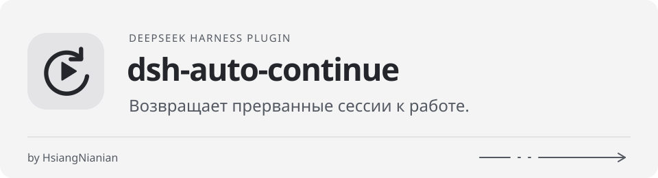
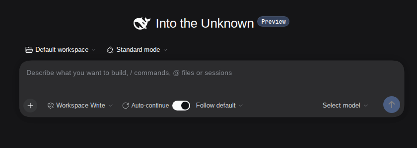
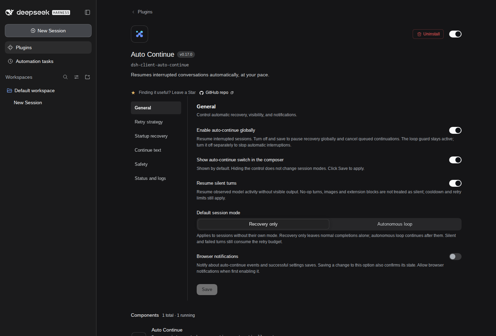

<p align="center">
  <picture>
    <source media="(prefers-color-scheme: dark)" srcset="docs/banner-ru-dark.svg">
    
  </picture>
</p>

<p align="center">
  Плагин для <a href="https://github.com/deepseek-ai/deepseek-harness">DeepSeek Harness</a>: сам продолжает прерванные сессии, а по желанию работает в автономном цикле.
</p>

<p align="center">
  <a href="https://www.npmjs.com/package/dsh-client-auto-continue"></a>
  <a href="https://www.npmjs.com/package/dsh-client-auto-continue"></a>
  <a href="https://github.com/HsiangNianian/dsh-auto-continue/stargazers"></a>
  <a href="LICENSE"></a>
  <a href="https://awesome-dsh-plugin.com"></a>
  <a href="https://www.dsh.so/artifact/dsh-auto-continue/"></a>
</p>

<p align="center">
  <a href="README.md">English</a> · <a href="README.zh.md">中文</a> · <b>Русский</b> · <a href="CHANGELOG.md">Changelog</a>
</p>

## Содержание

- [Что делает плагин](#что-делает-плагин)
- [Установка](#установка)
- [Использование](#использование)
- [Настройка](#настройка)
- [Как это работает](#как-это-работает)
- [Решение проблем](#решение-проблем)
- [Конфиденциальность и разрешения](#конфиденциальность-и-разрешения)
- [Разработка](#разработка)
- [Ссылки](#ссылки)
- [Лицензия](#лицензия)

## Что делает плагин

Если ход завершился восстановимой ошибкой, упёрся в лимит вывода, закончился без видимого ответа или был оборван перезапуском хоста, плагин выжидает несколько секунд и сам отправляет сообщение «продолжай». Он работает внутри хоста DSH, поэтому продолжает следить за сессиями и после закрытия вкладки браузера, а все вкладки используют один и тот же движок.

<p align="center">
  <picture>
    <source media="(prefers-reduced-motion: reduce)" srcset="docs/demo-ru-static.svg">
    
  </picture>
</p>

- **Восстановление после ошибок.** Сетевые ошибки, тайм-ауты, 5xx и 429 повторяются: сначала пауза перед отправкой, затем интервал, который растёт после каждой неудачи, и лимит попыток подряд. Постоянные ошибки (авторизация, баланс, неизвестная модель, слишком длинный контекст) пропускаются.
- **Ожидание сети.** При сетевых сбоях плагин ждёт, пока связь вернётся, и не тратит попытки впустую.
- **Восстановление после запуска.** После перезапуска хоста продолжаются сессии, прерванные за последние 15 минут, в том числе те, которые вы ещё не открывали.
- **Режимы сессий.** Переключатель рядом с полем ввода задаёт для каждой беседы свой режим: «Как по умолчанию», «Выключено», «Только восстановление» или «Автономный цикл».
- **Автономный цикл (включается вручную).** Сессия продолжает работу и после штатного завершения хода, при желании с лимитом раундов.
- **Защита.** Перед продолжением модель узнаёт, завершился ли последний вызов инструмента, а защита от зацикливания прерывает ходы, которые повторяют одно и то же.
- **Наглядность.** На странице настроек видны статистика за сегодня, последние попытки восстановления и сессии на паузе. Можно включить уведомления браузера с кнопками **Продолжить сейчас** и **Приостановить сессию на 1 час**.

## Установка

Плагины DSH устанавливаются в профиль; `dsh web` использует профиль `web`. В десктопном приложении ставьте плагин через его страницу **Plugins**, а не через CLI.

### Установка из npm (рекомендуется)

```bash
dsh plugin --profile web add dsh-client-auto-continue@latest
dsh web
```

После установки перезапустите DSH и обновите страницу в браузере. Затем откройте **Plugins → dsh-client-auto-continue** в боковой панели и убедитесь, что статус — **Running**.

Чтобы обновиться, дождитесь окончания текущей работы, остановите DSH, выполните ту же команду ещё раз, затем перезапустите DSH и обновите страницу. Настройки сохраняются в профиле. У десктопного приложения свой профиль: обновляйте плагин на его странице **Plugins**.

### Совместимость

| Среда DSH | Версия плагина | Где настройки |
| --- | --- | --- |
| 0.2.2-rc.1, 0.2.1-rc.2, 0.2.1-alpha.1 | 0.19.0 проверена | **Plugins → dsh-client-auto-continue** |
| 0.2.0-rc.1 | 0.12.1 и новее | **Plugins → dsh-client-auto-continue** |
| 0.1.7-rc.2 | 0.11.9 и новее | **Plugins → dsh-client-auto-continue** |
| Старые хосты с устаревшим API настроек | старый интерфейс | **Settings → Plugins → Plugin configuration** |

DSH 0.1.0-rc.6 и более ранние версии не поддерживаются. Плагин 0.11.9 и 0.12.0 не проходят проверку версии в DSH 0.2.0-rc.1 ([#50](https://github.com/HsiangNianian/dsh-auto-continue/issues/50)). Версия десктопного приложения не совпадает с версией среды DSH; ориентируйтесь на версию среды (для CLI — `dsh --version`).

<details>
<summary>Установка с GitHub (ветка <code>main</code>)</summary>

Собранные файлы лежат в репозитории, поэтому клонировать и собирать ничего не нужно:

```bash
dsh plugin --profile web add github:HsiangNianian/dsh-auto-continue
dsh web
```

Так вы получаете ветку `main`, а не релизы. Чтобы сменить источник, выполните `dsh plugin --profile web add <другой источник>`; зависимость в профиле заменится на месте.

</details>

<details>
<summary>Установка из локальной копии</summary>

Нужен Node.js 22.

```bash
git clone https://github.com/HsiangNianian/dsh-auto-continue.git
cd dsh-auto-continue
npm ci
npm run build
dsh plugin --profile web add "link:$(pwd)"
dsh web
```

Пакет содержит свой `cordis.patch.yml` (`dsh.bundle.patch`), поэтому плагин регистрируется сам. После правок кода выполните `npm run build`, перезапустите DSH и обновите страницу.

</details>

<details>
<summary>Переход со старой ручной установки</summary>

Раньше плагин подключали симлинком и вручную прописанной строкой `insert` в конфигурации загрузчика. В таком виде движок может работать, но на странице **Plugins** плагина не видно.

1. Дождитесь окончания текущей работы и остановите `dsh web`. Сделайте резервные копии `package.json`, `cordis.patch.yml` и `pnpm-lock.yaml` из `~/.dsh/profiles/web/`, а также `~/.dsh/settings.yaml`, если он есть (если задан `$DSH_HOME`, используйте его вместо `~/.dsh`).
2. В `cordis.patch.yml` удалите только ручную строку `auto-continue` внутри списка `insert` (и сам список, если он опустел). Запись верхнего уровня `- id: auto-continue` с `config:` — это ваши настройки, её оставьте.
3. Установите плагин командой для npm или GitHub выше. После этого в `package.json` профиля в `dsh.profile.bundles` должен появиться `dsh-client-auto-continue`.
4. Если в старом `settings.yaml` есть раздел `auto-continue`, перенесите его значения в запись в `cordis.patch.yml` профиля:

   ```yaml
   - id: auto-continue
     config:
       cooldownMs: 45000 # ваше сохранённое значение
   ```

5. Запустите `dsh web`, обновите страницу, откройте **Plugins → dsh-client-auto-continue** и проверьте значения.

Если хост поддерживает и конфигурацию профиля, и устаревший API настроек ([#64](https://github.com/HsiangNianian/dsh-auto-continue/issues/64)), плагин один раз для каждого профиля импортирует раздел `auto-continue` из `$DSH_HOME/settings-legacy.yaml`. Значения, уже заданные в профиле, имеют приоритет, а старый файл не меняется. Пока импорт не завершён, восстановление ждёт; если импорт не удался, хост пишет ошибку в лог и продолжает ждать, пока вы не исправите файл или права доступа и не перезапустите его.

Метка `include:auto-continue` в разделе **Built-in plugins** — обычный префикс загрузчика, а не признак двойной установки.

</details>

<details>
<summary>Проверка и удаление</summary>

```bash
# в итоговой конфигурации должна быть ровно одна запись auto-continue
dsh --profile web --dump-config | grep -A 4 'id: auto-continue'

# удаление
dsh plugin --profile web remove dsh-client-auto-continue
```

Если в `cordis.patch.yml` профиля осталась запись `- id: auto-continue`, удалите и её, затем перезапустите DSH.

</details>

## Использование

Восстановление включено по умолчанию, дополнительно ничего настраивать не нужно.

Интерфейс плагина переведён на русский: при русском языке DSH настройки, меню режимов, уведомления и встроенные тексты продолжения показываются по-русски. Страница **Plugins** и другие элементы самого DSH могут оставаться на английском.

### Режимы сессий

Переключатель **Авто-продолжение** рядом с полем ввода действует только на текущую беседу. Меню рядом с ним выбирает режим:

| Режим | Что происходит |
| --- | --- |
| Как по умолчанию | Берётся **Режим сессии по умолчанию** из настроек (по умолчанию «Только восстановление») |
| Выключено | В этой беседе нет автоматических сообщений и прерываний защитой от зацикливания |
| Только восстановление | Восстанавливаются ошибки, лимит вывода, пустые ходы и прерывания перезапуском; штатно завершённые ходы не трогаются |
| Автономный цикл | Плюс продолжение после каждого штатного завершения, с текстом для цикла |

Выключение переключателя выбирает «Выключено», повторное включение — «Как по умолчанию». Выбор сразу сохраняется на хосте (`sessionModes`), синхронизируется между вкладками и переживает перезапуск. Переход в Off отменяет всё, что ждёт отправки, но текущий ход доработает до конца.

<p align="center">
  
</p>

В узком окне подпись и меню сворачиваются в значок. В DS-Bot и dsh-pocket такая компактная раскладка действует до ширины 640 CSS-пикселей. Чтобы скрыть элементы, выключите **Показывать переключатель авто-продолжения в поле ввода** в разделе **Общие** и сохраните; режимы сессий при этом не меняются.

### Пауза и ручное управление

- **Включить авто-продолжение глобально** (раздел **Общие**) — главный выключатель. Если его выключить, автоматические сообщения прекращаются, но выбор для каждой беседы сохраняется. Защита от зацикливания продолжает работать; чтобы совсем избежать прерываний, выключите и **Защита от циклов**.
- **Приостановить сессию на 1 час** (кнопка в уведомлении) ставит одну беседу на паузу на час.
- **Продолжить сейчас** (кнопка в уведомлении) сразу отправляет одно сообщение «продолжай». Интервал между попытками, лимит подряд и паузы не мешают, но и пауза при этом не снимается.
- Ваше собственное сообщение или начало нового хода отменяют всё, что ещё ждёт отправки.

### Статус и логи

В разделе **Состояние и журнал** видны счётчики за сегодня (отправленные сообщения, удачные восстановления, сбои, пропущенные ошибки, отказы, прерванные циклы — по кодам ошибок, с кнопкой сброса), последние 20 попыток восстановления по сессиям и сессии, стоящие на паузе. Эти данные хранятся в памяти хоста и обнуляются при перезапуске плагина. Если включены **Подробный журнал**, каждое решение пишется в лог DSH с префиксом `[auto-continue]` (при работе через CLI — в терминал, где запущен `dsh web`).

## Настройка

Откройте **Plugins → dsh-client-auto-continue** в боковой панели и выберите раздел. (**Settings → Built-in plugins** показывает только статус компонентов, редактировать там нельзя.) Изменения сначала копятся и вступают в силу после **Сохранить**; при переходе между разделами черновик не теряется, некорректные значения не дают сохранить, а **Сбросить** убирает переопределение.



Настройки хранятся в записи `auto-continue` патча активного профиля: для профиля web по умолчанию это `~/.dsh/profiles/web/cordis.patch.yml` (на старых хостах — раздел `auto-continue:` в `~/.dsh/settings.yaml`). Файл можно править вручную; для отсутствующих ключей действуют значения по умолчанию:

```yaml
- id: auto-continue
  config:
    cooldownMs: 45000
    resumeCompletedTurns: true
    loopMaxIterations: 20
```

Время указывается в миллисекундах. Пустые текстовые поля означают встроенный текст на текущем языке.

### Общие

| Настройка | Ключ | По умолчанию | Пояснение |
| --- | --- | --- | --- |
| Включить авто-продолжение глобально | `paused` | `false` | Хранится в инвертированном виде: `paused: true` останавливает все автоматические сообщения и отменяет ожидающие |
| Показывать переключатель авто-продолжения в поле ввода | `showComposerToggle` | `true` | Только показывает или скрывает элементы |
| Отправлять сообщения автопродолжения с меткой плагина | `usePluginSource` | `false` | Выкл. — сообщения уходят с источником `user`; вкл. — помечаются как `plugin:dsh-client-auto-continue` |
| Продолжать ходы без вывода | `resumeSilentTurns` | `true` | Продолжать ходы, в которых модель работала, но видимого ответа нет; они учитываются в **Максимум подряд** |
| Продолжать сессии субагентов | `resumeSubagentSessions` | `false` | Продолжать упавший, обрезанный или пустой ход субагента, пока он ещё загружен, в режиме его основного диалога. DSH обычно сразу закрывает фоновый субагент после сбоя, так что это помогает в основном субагентам, которые остаются загруженными |
| Режим сессии по умолчанию | `resumeCompletedTurns` | `false` | Для бесед в режиме «Как по умолчанию»: `false` — «Только восстановление», `true` — «Автономный цикл» |
| Лимит раундов автономного цикла | `loopMaxIterations` | `0` | Раундов цикла на сессию, `0` — без лимита. Счёт начинается заново, когда вы пишете сообщение или снова включаете цикл |
| Уведомления браузера | `notify` | `false` | Уведомления об отправках, пропусках, отказах и сохранении настроек; при первом включении браузер попросит разрешение |

### Стратегия повторов

| Настройка | Ключ | По умолчанию | Пояснение |
| --- | --- | --- | --- |
| Период ожидания (мс) | `graceMs` | `3000` | Пауза перед отправкой; новый ход или ваше сообщение её отменяют |
| Задержка перед повтором (мс) | `cooldownMs` | `20000` | Минимальный интервал между попытками в одной сессии; сбой внутри интервала ждёт его окончания |
| Максимум подряд | `maxConsecutive` | `3` | Попыток подряд до отказа. Сбрасывается, когда вы пишете сообщение или ход даёт видимый ответ; продолжения цикла после штатного завершения не считаются |
| Классификация ошибок | `classify` | `true` | Повторять только временные ошибки, постоянные пропускать. Выкл. — повторять все |
| Свои восстанавливаемые ошибки | `retryableErrorPatterns` | `''` | По одному фрагменту на строку, без учёта регистра; ищется в коде, HTTP-статусе и тексте ошибки. Важнее встроенной классификации |
| Коэффициент задержки | `backoffFactor` | `2` | Множитель интервала после каждого сбоя подряд (20 с → 40 с → 80 с) |
| Максимальная задержка (мс) | `backoffMaxMs` | `300000` | Верхняя граница интервала |
| Пауза при отсутствии сети | `pauseWhenOffline` | `true` | Пока у хоста нет сети, повтор сетевых ошибок ждёт и не тратит попытки |
| Интервал повторной проверки сети (мс) | `offlineCheckMs` | `15000` | Как часто проверять сеть во время ожидания; минимум 1000 |
| Перевзводить цели, снятые перезапуском | `resumeGoals` | `false` | После отправки снова «взводит» цель (goal) в состоянии `active`, которую перезапуск снял. Это действие от вашего имени, поэтому по умолчанию выключено |
| Возобновлять приостановленные цели | `resumePausedGoals` | `false` | Продолжать и цели, которые вы поставили на паузу сами. Работает только вместе с `resumeGoals` |

### Восстановление при запуске

| Настройка | Ключ | По умолчанию | Пояснение |
| --- | --- | --- | --- |
| Сканирование при запуске хоста | `scanOnBoot` | `true` | После запуска хоста искать прерванные сессии, открытые и сохранённые |
| Будить дочерние сессии после перезапуска | `resumeInterruptedChildren` | `false` | Отправить корневой сессии одно сообщение со списком прерванных сессий субагентов и участников команды |
| Лимит сканирования | `scanLimit` | `8` | Сколько сессий восстанавливать за проход, сначала самые свежие |
| Окно сканирования (мс) | `freshMs` | `900000` | Восстанавливаются только прерывания не старше этого срока; сканирование тоже заканчивается по его истечении |

### Текст продолжения

| Настройка | Ключ | Когда используется |
| --- | --- | --- |
| Текст продолжения | `continueText` | Ход завершился ошибкой |
| Текст продолжения (лимит токенов) | `continueTextMaxTokens` | Достигнут лимит токенов вывода |
| Текст продолжения (ход без вывода) | `continueTextSilent` | Ход закончился одними рассуждениями |
| Текст продолжения (после перезапуска хоста) | `continueTextInterrupted` | Стартовое сканирование продолжает ход, оборванный перезапуском |
| Текст продолжения (автономный цикл) | `continueTextLoop` | Каждый раунд автономного цикла |
| Текст защиты (результат не подтверждён) | `guardPendingText` | Добавляется, если последний вызов инструмента мог не завершиться |
| Текст защиты (инструмент выполнен) | `guardDoneText` | Добавляется, если последний вызов инструмента прошёл успешно |
| Текст цикла | `loopText` | Защита от зацикливания перезапустила ход |

У всех значение по умолчанию `''`, то есть встроенный текст. Тексты продолжения понимают `{code}`, `{message}`, `{status}`, `{tool}`, `{turn}`, `{errorCount}` и `{elapsed}`: например, `Продолжай ({tool}: {code})` превратится в `Продолжай (git push: UPSTREAM)`. В текстах защиты и `loopText` доступен `{tool}`, в `guardDoneText` — ещё и `{result}` (короткий фрагмент вывода инструмента).

Встроенные тексты есть на английском, китайском и русском и следуют языку DSH: `ru` и `ru-*` — русский, `zh` и `zh-*` — китайский, все остальные — английский. Непустой текст, который вы вписали сами, при смене языка не заменяется.

<details>
<summary>Встроенные тексты (русские)</summary>

| Ключ | Текст |
| --- | --- |
| `continueText`, `continueTextMaxTokens`, `continueTextLoop` | `Продолжай` |
| `continueTextSilent` | `Продолжай. Предыдущий ход закончился только внутренним рассуждением: ни ответа, ни вызова инструмента, поэтому пользователь ничего не увидел. Каждый ход должен заканчиваться вызовом инструмента или видимым ответом.` |
| `continueTextInterrupted` | `Продолжай. Хост перезапустился, пока предыдущий ход ещё выполнялся; вызовы инструментов, незавершённые на момент перезапуска, записаны с неизвестным результатом. Продолжай с места остановки, проверяя внешнее состояние перед повтором действий с возможными побочными эффектами.` |
| `guardPendingText` | `(Предыдущий инструмент «{tool}», возможно, не завершился. Проверь его состояние перед продолжением и не запускай его повторно.)` |
| `guardDoneText` | `(Предыдущий инструмент «{tool}» завершился успешно. Результат: {result}; не запускай его повторно, продолжай с этого места.)` |
| `loopText` | `(Похоже, ты застрял в цикле. Перестань повторять последнее действие и продолжай другим способом.)` |

</details>

### Защита

| Настройка | Ключ | По умолчанию | Пояснение |
| --- | --- | --- | --- |
| Защита от повторного выполнения | `guardTools` | `true` | Перед продолжением сообщать модели, завершился ли последний вызов инструмента, чтобы она не повторила его |
| Защита от циклов | `loopGuard` | `true` | Прерывать ход, который повторяет одно и то же, и запускать его заново с `loopText` |
| Макс. длина короткой фразы (символов) | `loopShortChars` | `40` | Сообщения короче этого считаются короткими фразами |
| Окно коротких фраз (мс) | `loopWindowMs` | `30000` | Окно для подсчёта коротких фраз; минимум 1000 |
| Порог коротких фраз | `loopShortCount` | `12` | Сколько коротких фраз подряд в окне без вызовов инструментов включают защиту |
| Порог одинаковых сообщений | `loopRepeatText` | `4` | Сколько одинаковых сообщений подряд (или повторов абзаца в одном потоковом сообщении) включают защиту |
| Порог повторов инструмента | `loopToolRepeat` | `5` | Сколько вызовов одного инструмента с теми же аргументами и результатом включают защиту |

### Состояние и журнал

| Настройка | Ключ | По умолчанию | Пояснение |
| --- | --- | --- | --- |
| Подробный журнал | `verbose` | `true` | Писать решения в лог с префиксом `[auto-continue]` |

Ещё два ключа записывает сам плагин: `locale` (повторяет язык DSH, по умолчанию `en`) и `sessionModes` (режимы, выбранные у поля ввода, по умолчанию `{}`). Обычно их не трогают.

### Классификация ошибок

Когда **Классификация ошибок** включён, повторяются сетевые ошибки, тайм-ауты, HTTP 5xx и 429. HTTP 401 и 403, а также коды и сообщения про авторизацию, учётные данные и API-ключи, баланс и квоты, неизвестную модель или длину контекста считаются постоянными и пропускаются (с уведомлением, если оно включено). `MALFORMED_RESPONSE` всегда можно повторить, если в нём нет явного 401 или 403.

Если провайдер возвращает ошибку, которую точно можно безопасно повторить (сначала проверьте, что ручное «продолжай» помогает), добавьте узкий и стабильный фрагмент вместо того, чтобы отключать классификацию целиком:

```yaml
- id: auto-continue
  config:
    retryableErrorPatterns: |-
      Upstream rejected the request as invalid
```

Это обычные подстроки, а не регулярные выражения. Интервал между попытками и **Максимум подряд** продолжают действовать.

## Как это работает

[](docs/auto-continue-workflow.en.html)

1. **Источники.** Движок слушает события сессий в хосте. Процесс запускает `turn/end` с причиной `error`, `max-tokens`, завершение без видимого ответа или `completed` (только в режиме цикла). После перезапуска хоста стартовое сканирование каждые 3 секунды проверяет открытые и сохранённые сессии, пока не закончится окно сканирования. Защита от зацикливания следит за идущими ходами и прерывает тот, что повторяется.
2. **Проверка сессии.** Ничего не отправляется, если auto-continue глобально на паузе, беседа в режиме «Выключено» или на часовой паузе, либо это сессия субагента, а **Продолжать сессии субагентов** выключено. Субагент следует режиму своего основного диалога (если у него нет своего), никогда не входит в автономный цикл и не попадает под защиту от циклов.
3. **Причина завершения.** Ручная остановка (Stop) и запрет политики (`blocked`) не трогаются, постоянные ошибки тоже. Всё остальное восстановимое идёт на восстановление. Штатное завершение продолжается только в режиме Autonomous loop: без интервала и лимита попыток подряд, но с учётом `loopMaxIterations`.
4. **Лимит попыток.** На **Максимум подряд** восстановление останавливается. Внутри интервала отправка откладывается, а не теряется; после каждого сбоя интервал умножается на коэффициент, пока не дойдёт до максимума.
5. **Пауза перед отправкой.** Движок ждёт `graceMs`. Новый ход или ваше сообщение отменяют отправку.
6. **Ожидание сети.** Для сетевых ошибок хост проверяет, есть ли сетевой интерфейс кроме loopback и разрешается ли хотя бы одно публичное имя. Без сети отправка ждёт, проверка повторяется каждые `offlineCheckMs`, а потом снова проходят пауза и интервал. Если задан `HTTP(S)_PROXY` или `ALL_PROXY`, проверяются только интерфейсы.
7. **Отправка.** Движок выбирает текст по причине остановки, добавляет заметку о последнем инструменте и отправляет через `agent.followup` с пресетом и моделью сессии. Если в очереди уже есть ходы пользователя, сообщение встаёт перед ними, а их порядок сохраняется. При включённом `resumeGoals` снятая перезапуском цель снова взводится.

**Дочерние сессии.** Кроме **Продолжать сессии субагентов** (только для ещё загруженных субагентов), сессии субагентов и участников команды напрямую не продолжаются. После перезапуска, если включено **Будить дочерние сессии после перезапуска**, стартовое сканирование собирает прерванные перезапуском дочерние сессии (не больше 8 логов за проход) и отправляет их корневой сессии одно сообщение со списком, один раз на пачку. Корневая сессия сама решает, продолжать или сворачиваться. Корень, у которого ещё идёт ход, остаётся обычному восстановлению, а корень, который вы остановили сами, не будится никогда.

**Нечитаемые сессии.** Если историю сессии не удаётся прочитать при стартовом сканировании, она пропускается с ошибкой в логе, а остальные сессии восстанавливаются ([#58](https://github.com/HsiangNianian/dsh-auto-continue/issues/58)). Исправьте её и перезапустите DSH в пределах окна сканирования, чтобы попробовать снова.

## Решение проблем

| Симптом | Что проверить |
| --- | --- |
| «Skipping profile bundle» или «incompatible with dsh 0.2.0-rc.1» | Обновите плагин до 0.12.1 или новее в том профиле, который реально использует приложение, и перезапустите его |
| Плагин включён, но полей настроек нет | Откройте основную страницу **Plugins**, а не **Settings → Built-in plugins**, и выберите **Общие** |
| `/api/auto-continue-bridge` отвечает 404 | Компонент хоста не загрузился. Проверьте лог запуска DSH и `--dump-config`, затем обновите страницу |
| После ошибки продолжения не было | Проверьте главный выключатель и режим беседы. Посмотрите строки `[auto-continue]` в логе: там видно, признана ли ошибка постоянной, достигнут ли **Максимум подряд** или отправка ждёт сеть |
| После перезапуска сессии не продолжились | Должен быть включён **Сканирование при запуске хоста**, а прерывание — моложе окна сканирования (по умолчанию 15 минут) |
| После миграции настройки не применяются | В `cordis.patch.yml` должна быть одна запись верхнего уровня `- id: auto-continue` и не должно остаться строки в `insert`; см. заметки о переходе в разделе [Установка](#установка) |
| На телефоне нет компактной раскладки | После обновления плагина перезапустите DSH и обновите удалённую страницу |

## Конфиденциальность и разрешения

- Движок работает в хосте DSH и читает события и историю сессий через сервисы DSH. Сторонние сервисы не используются, учётные данные не хранятся.
- Сообщения продолжения отправляются через `agent.followup`; защита от зацикливания перед этим может вызвать `agent.cancel`. Продолженный агент сохраняет инструменты и разрешения сессии.
- Проверка сети читает локальные сетевые интерфейсы и делает DNS-запрос для `api.deepseek.com`, `www.baidu.com` и `one.one.one.one`. Соединения не открываются, запросы не отправляются.
- Настройки сохраняются через API настроек DSH в активный профиль (на старых хостах — в `~/.dsh/settings.yaml`). Счётчики попыток, интервалы, часовые паузы и статистика хранятся только в памяти.
- Уведомления браузера включаются вручную. Разрешение запрашивается только тогда, когда вы их включаете и сохраняете.

## Разработка

Нужен Node.js 22.

```bash
npm ci
npm run typecheck
npm run build
npm test
```

`npm run test:runtime` прогоняет тесты настроек, стартового восстановления и перезапуска на опубликованных пакетах DSH. Сначала установите зафиксированные окружения:

```bash
for v in 0.1.7 0.2.0 0.2.0-rc.2 0.2.1 0.2.1-rc.2; do npm ci --prefix "tests/fixtures/dsh-$v"; done
npm run test:runtime
```

Эти тесты используют настоящие сервисы DSH с детерминированным адаптером модели и не обращаются к провайдерам моделей. CI также проверяет, что закоммиченный `lib/` совпадает со свежей сборкой, и запускает [dsh-plugin-check](https://github.com/omdsh-dev/dsh-plugin-check).

Баннеры и превью для соцсетей генерирует `npm run docs:assets`; схема работы — экспорт [Archify](https://github.com/tt-a1i/archify) (`docs/auto-continue-workflow.*`, исходники в `*.archify.json`) (PNG рендерится командой `rsvg-convert -w 1280 -h 640 docs/social-preview.svg -o docs/social-preview.png`). Как снимать скриншоты, описано в [docs/screenshots/README.md](docs/screenshots/README.md).

## Ссылки

- Репозиторий: [github.com/HsiangNianian/dsh-auto-continue](https://github.com/HsiangNianian/dsh-auto-continue)
- npm: [dsh-client-auto-continue](https://www.npmjs.com/package/dsh-client-auto-continue)
- DeepSeek Harness: [github.com/deepseek-ai/deepseek-harness](https://github.com/deepseek-ai/deepseek-harness)
- dsh-plugin-check: [github.com/omdsh-dev/dsh-plugin-check](https://github.com/omdsh-dev/dsh-plugin-check)
- LINUX DO: [linux.do](https://linux.do)

[](https://gitstock.org/HsiangNianian/dsh-auto-continue)

## Лицензия

[MIT](LICENSE) © Hsiang Nianian
