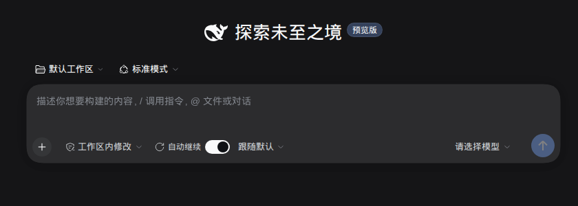

<p align="center">
  <picture>
    <source media="(prefers-color-scheme: dark)" srcset="docs/banner-zh-dark.svg">
    
  </picture>
</p>

<p align="center">
  <a href="https://github.com/deepseek-ai/deepseek-harness">DeepSeek Harness</a> 插件：会话意外中断时替你接着跑，也可以开启自主循环。
</p>

<p align="center">
  <a href="https://www.npmjs.com/package/dsh-client-auto-continue"></a>
  <a href="https://www.npmjs.com/package/dsh-client-auto-continue"></a>
  <a href="https://github.com/HsiangNianian/dsh-auto-continue/stargazers"></a>
  <a href="LICENSE"></a>
  <a href="https://awesome-dsh-plugin.com"></a>
  <a href="https://www.dsh.so/artifact/dsh-auto-continue/"></a>
</p>

<p align="center">
  <a href="README.md">English</a> · <b>中文</b> · <a href="README.ru.md">Русский</a> · <a href="CHANGELOG.md">更新日志</a>
</p>

## 目录

- [功能](#功能)
- [安装](#安装)
- [使用](#使用)
- [配置](#配置)
- [工作原理](#工作原理)
- [常见问题](#常见问题)
- [隐私与权限](#隐私与权限)
- [开发](#开发)
- [链接](#链接)
- [许可证](#许可证)

## 功能

回合因可恢复的错误失败、触到输出上限、结束时没有可见输出，或者被宿主重启打断时，插件会等几秒，然后替你发一条继续消息。引擎运行在 DSH 宿主进程里，关掉浏览器标签页也照常工作，所有标签页共用同一个引擎。

<p align="center">
  <picture>
    <source media="(prefers-reduced-motion: reduce)" srcset="docs/demo-zh-static.svg">
    
  </picture>
</p>

- **错误恢复。** 网络错误、超时、5xx 和 429 会自动重试：先等宽限期，冷却时间随失败次数递增，连续次数有上限。认证、余额、模型不存在、上下文超长这类永久性错误直接跳过。
- **断网挂起。** 网络类失败会等网络恢复再发，不白白消耗重试次数。
- **启动恢复。** 宿主重启后，最近 15 分钟内被打断的会话会继续，包括你还没重新打开的会话。
- **会话模式。** 输入框旁的开关可以把每个会话单独设为跟随默认、关闭、仅故障恢复或自主循环。
- **自主循环(需手动开启)。** 正常完成后也继续跑，可以设轮数上限。
- **安全保护。** 幂等护栏告诉模型上一步工具调用是否完成；循环守卫会打断原地打转的回合。
- **可观察。** 设置页能看到今日统计、最近的恢复记录和暂停中的会话；可选的浏览器通知带有 **立即续跑** 和 **暂停该会话 1 小时** 按钮。

## 安装

DSH 插件装在 profile 里；`dsh web` 用的是 `web` profile。桌面应用请在应用自己的 **插件** 页面安装，不要用 CLI。

### 从 npm 安装(推荐)

```bash
dsh plugin --profile web add dsh-client-auto-continue@latest
dsh web
```

装好后重启 DSH 并刷新浏览器，然后从主侧边栏打开 **插件 → dsh-client-auto-continue**，确认状态是 **运行中**。

更新时，先等进行中的工作结束并停止 DSH，再执行一遍上面的命令，然后重启 DSH、刷新浏览器。原有设置会保留在 profile 中。桌面应用使用独立的 profile，需要在应用的 **插件** 页面更新。

### 版本兼容

| DSH 内核 | 插件版本 | 设置入口 |
| --- | --- | --- |
| 0.2.2-rc.1、0.2.1-rc.2、0.2.1-alpha.1 | 0.19.0 已验证 | **插件 → dsh-client-auto-continue** |
| 0.2.0-rc.1 | 0.12.1 及以上 | **插件 → dsh-client-auto-continue** |
| 0.1.7-rc.2 | 0.11.9 及以上 | **插件 → dsh-client-auto-continue** |
| 仅有旧版设置 API 的宿主 | 旧版界面 | **设置 → 插件 → 插件配置** |

不支持 DSH 0.1.0-rc.6 及更早版本。插件 0.11.9 和 0.12.0 会被 DSH 0.2.0-rc.1 的版本检查拦下([#50](https://github.com/HsiangNianian/dsh-auto-continue/issues/50))。桌面应用的版本号不是 DSH 内核版本，请以内核版本为准(CLI 可运行 `dsh --version`)。

<details>
<summary>从 GitHub 安装(跟随 <code>main</code> 分支)</summary>

构建产物已提交到仓库，不需要克隆或构建：

```bash
dsh plugin --profile web add github:HsiangNianian/dsh-auto-continue
dsh web
```

这种方式跟随 `main` 分支而不是正式版本。想换安装来源，再执行一次 `dsh plugin --profile web add <其他来源>` 即可，profile 里的依赖会被原地替换。

</details>

<details>
<summary>从本地仓库安装</summary>

需要 Node.js 22。

```bash
git clone https://github.com/HsiangNianian/dsh-auto-continue.git
cd dsh-auto-continue
npm ci
npm run build
dsh plugin --profile web add "link:$(pwd)"
dsh web
```

包里自带 `cordis.patch.yml`(通过 `dsh.bundle.patch` 声明)，插件会自动注册。改完代码后运行 `npm run build`，再重启 DSH、刷新浏览器。

</details>

<details>
<summary>迁移旧的手动安装</summary>

早期的安装方式是软链接加手写的 `insert` 加载行。这样引擎可能能启动，但 **插件** 页面里看不到它。

1. 等进行中的工作结束，停止 `dsh web`。备份 `~/.dsh/profiles/web/` 下的 `package.json`、`cordis.patch.yml` 和 `pnpm-lock.yaml`，如果有 `~/.dsh/settings.yaml` 也一并备份(设置了 `$DSH_HOME` 的话用它代替 `~/.dsh`)。
2. 在 `cordis.patch.yml` 中，只删除 `insert` 列表里手写的 `auto-continue` 行(列表空了就连列表一起删)。顶层带 `config:` 的 `- id: auto-continue` 是你的设置，要保留。
3. 用上面的 npm 或 GitHub 命令安装。之后 profile 的 `package.json` 中 `dsh.profile.bundles` 应包含 `dsh-client-auto-continue`。
4. 如果旧的 `settings.yaml` 里有 `auto-continue` 段落，把其中的值合并到 profile 的 `cordis.patch.yml` 条目：

   ```yaml
   - id: auto-continue
     config:
       cooldownMs: 45000 # 换成你自己保存的值
   ```

5. 启动 `dsh web`，刷新浏览器，打开 **插件 → dsh-client-auto-continue** 检查各项设置。

对于同时提供 profile 配置和旧版设置 API 的宿主([#64](https://github.com/HsiangNianian/dsh-auto-continue/issues/64))，插件会为每个 profile 从 `$DSH_HOME/settings-legacy.yaml` 的 `auto-continue` 段落导入一次旧值。profile 里已有的值优先，旧文件保持不变。导入完成前自动恢复会等待；导入失败时宿主会记录错误并一直等待，修好文件或权限后重启即可。

**内置插件** 里显示的 `include:auto-continue` 是正常的加载前缀，不代表重复安装。

</details>

<details>
<summary>验证与卸载</summary>

```bash
# 合成后的配置里应当只有一个 auto-continue 条目
dsh --profile web --dump-config | grep -A 4 'id: auto-continue'

# 卸载
dsh plugin --profile web remove dsh-client-auto-continue
```

如果 profile 的 `cordis.patch.yml` 里还有 `- id: auto-continue` 条目，也一并删除，然后重启 DSH。

</details>

## 使用

故障恢复默认开启，不需要额外设置。

### 会话模式

输入框旁的 **自动继续** 开关只作用于当前会话，旁边的菜单用来选择模式：

| 模式 | 行为 |
| --- | --- |
| 跟随默认 | 使用设置里的 **默认会话模式**(未修改时为仅故障恢复) |
| 关闭 | 这个会话不自动发消息，循环守卫也不打断 |
| 仅故障恢复 | 恢复错误、输出超限、无输出回合和重启中断；正常完成的回合不动 |
| 自主循环 | 每次正常完成后也继续，使用自主循环的继续文本 |

关掉开关即选择“关闭”，再打开即回到“跟随默认”。选择会立即保存在宿主上(`sessionModes`)，在标签页之间同步，重启后依然有效。把会话切到“关闭”会取消所有待发送的继续消息，但不会中断正在运行的回合。

<p align="center">
  
</p>

窗口较窄时，文字和菜单会收成图标。DS-Bot 和 dsh-pocket 在 640 CSS 像素以内也使用这种紧凑布局。想隐藏这组控件，在 **常规** 中关闭 **在会话区显示自动继续开关** 并保存；这不会改变任何会话的模式。

### 暂停与手动控制

- **常规** 里的 **全局启用自动继续** 是总开关。关闭后停止所有自动消息，但会保留各会话的选择。循环守卫仍会运行；如果完全不想被打断，把 **循环守卫** 也关掉。
- **暂停该会话 1 小时**(通知按钮)让单个会话暂停一小时。
- **立即续跑**(通知按钮)马上发送一次继续消息，不受冷却、连续上限和暂停限制，但不会解除暂停。
- 你自己发消息，或者有新回合开始，都会取消还在等待的继续消息。

### 状态与日志

**状态与日志** 分类显示今日统计(继续消息、恢复成功、失败、跳过的错误、放弃、循环打断，按错误码细分，可一键清零)、按会话分组的最近 20 次恢复记录，以及当前暂停的会话。这些数据保存在宿主内存中，插件重启后清零。开启 **详细日志** 后，每个决定都会以 `[auto-continue]` 前缀写入 DSH 日志(CLI 用户可在运行 `dsh web` 的终端里看到)。

## 配置

从主侧边栏打开 **插件 → dsh-client-auto-continue**，选择一个分类。(**设置 → 内置插件** 只列出组件状态，不能编辑。)修改会先暂存，点击 **保存** 后生效；切换分类不会丢失草稿，非法值会阻止保存，**恢复默认** 会移除覆盖值。


设置保存在当前 profile 补丁的 `auto-continue` 条目中，默认 web profile 是 `~/.dsh/profiles/web/cordis.patch.yml`(旧版宿主为 `~/.dsh/settings.yaml` 的 `auto-continue:` 段落)。也可以直接编辑文件，省略的键使用默认值：

```yaml
- id: auto-continue
  config:
    cooldownMs: 45000
    resumeCompletedTurns: true
    loopMaxIterations: 20
```

时间单位均为毫秒。文本类字段留空时使用当前语言的内置文本。

### 常规

| 设置项 | 键 | 默认值 | 说明 |
| --- | --- | --- | --- |
| 全局启用自动继续 | `paused` | `false` | 存储时取反：`paused: true` 停止所有自动消息并取消已排队的发送 |
| 在会话区显示自动继续开关 | `showComposerToggle` | `true` | 只控制显示与隐藏 |
| 以插件来源发送继续消息 | `usePluginSource` | `false` | 关闭时以 `user` 来源发送；开启后标记为 `plugin:dsh-client-auto-continue` |
| 续跑无输出回合 | `resumeSilentTurns` | `true` | 有模型活动但没有可见输出的回合也继续；仍计入 **最大连续次数** |
| 续跑子代理会话 | `resumeSubagentSessions` | `false` | 子代理失败、被截断或无输出时，按主会话的模式续跑。DSH 已经释放子代理时，引擎通过宿主的 subagent 服务从持久化会话冷恢复它；宿主无法恢复时，改为把失败交给主会话 |
| 默认会话模式 | `resumeCompletedTurns` | `false` | 用于“跟随默认”的会话：`false` 为仅故障恢复，`true` 为自主循环 |
| 自主循环轮数上限 | `loopMaxIterations` | `0` | 每个会话的循环轮数，`0` 为不限。你发消息或重新开启循环后重新计数 |
| 浏览器通知 | `notify` | `false` | 发送、跳过、放弃以及设置保存时通知；首次开启时浏览器会请求权限 |

### 重试策略

| 设置项 | 键 | 默认值 | 说明 |
| --- | --- | --- | --- |
| 宽限期 (ms) | `graceMs` | `3000` | 发送前的等待；期间有新回合或你发了消息就取消 |
| 冷却时间 (ms) | `cooldownMs` | `20000` | 同一会话两次恢复尝试的最小间隔；冷却期内的失败会等冷却结束 |
| 最大连续次数 | `maxConsecutive` | `3` | 达到后放弃。你发消息或回合有可见输出后清零；正常完成后的循环续跑不计入 |
| 错误分类 | `classify` | `true` | 只重试临时性错误，跳过永久性错误；关闭则所有错误都重试 |
| 自定义可恢复错误 | `retryableErrorPatterns` | `''` | 每行一个文本片段，忽略大小写，匹配错误码、HTTP 状态和消息；优先于内置分类 |
| 退避系数 | `backoffFactor` | `2` | 每次连续失败后冷却时间的倍数(20 秒 → 40 秒 → 80 秒) |
| 最大退避间隔 (ms) | `backoffMaxMs` | `300000` | 冷却时间的上限 |
| 断网时暂停续跑 | `pauseWhenOffline` | `true` | 宿主断网时挂起网络类错误的重试，不消耗次数 |
| 断网复检间隔 (ms) | `offlineCheckMs` | `15000` | 挂起期间多久检测一次网络，最小 1000 |
| 重新武装被重启失活的 goal | `resumeGoals` | `false` | 发出继续消息后，把重启时被 disarm 的 `active` goal 重新 arm。这相当于替你授权，所以默认关闭 |
| 恢复被暂停的 goal | `resumePausedGoals` | `false` | 连你手动暂停的 goal 也恢复；需同时开启 `resumeGoals` |

### 启动恢复

| 设置项 | 键 | 默认值 | 说明 |
| --- | --- | --- | --- |
| 启动恢复扫描 | `scanOnBoot` | `true` | 宿主启动后查找被打断的会话，包括已打开和已存储的 |
| 重启后唤醒子代理会话 | `resumeInterruptedChildren` | `false` | 给根会话发一条消息，列出被打断的子代理或团队成员会话 |
| 扫描会话数 | `scanLimit` | `8` | 每轮扫描最多恢复的会话数，最近活动的优先 |
| 扫描时间窗 (ms) | `freshMs` | `900000` | 只恢复这段时间内的中断；扫描也在这段时间后结束 |

### 继续文本

| 设置项 | 键 | 使用时机 |
| --- | --- | --- |
| 继续文本 | `continueText` | 回合因错误失败 |
| 超限时的继续文本 | `continueTextMaxTokens` | 触到输出 token 上限 |
| 无输出回合的继续文本 | `continueTextSilent` | 回合只输出了推理 |
| 宿主重启后恢复的继续文本 | `continueTextInterrupted` | 启动扫描恢复被重启打断的回合 |
| 自主循环的继续文本 | `continueTextLoop` | 自主循环的每一轮 |
| 结果未确认时的护栏文本 | `guardPendingText` | 上一步工具调用可能没完成时附加 |
| 工具已成功时的护栏文本 | `guardDoneText` | 上一步工具调用已成功时附加 |
| 循环提示文本 | `loopText` | 循环守卫重启回合时发送 |

默认值都是 `''`，即使用内置文本。继续文本支持 `{code}`、`{message}`、`{status}`、`{tool}`、`{turn}`、`{errorCount}` 和 `{elapsed}` 占位符，例如 `继续({tool}: {code})` 会变成 `继续(git push: UPSTREAM)`。护栏文本和循环提示文本支持 `{tool}`，`guardDoneText` 还支持 `{result}`(工具输出的简短摘录)。

内置文本有英文、中文和俄文三套，跟随 DSH 的界面语言：`zh` 和 `zh-*` 用中文，`ru` 和 `ru-*` 用俄文，其他语言一律用英文。你自己填写的非空文本不会因切换语言被替换。

<details>
<summary>内置中文文本</summary>

| 键 | 文本 |
| --- | --- |
| `continueText`、`continueTextMaxTokens`、`continueTextLoop` | `继续` |
| `continueTextSilent` | `继续。你上一轮只输出了内部推理, 既没有回复也没有调用工具, 用户什么都没看到。每一轮都要以工具调用或可见回复结束。` |
| `continueTextInterrupted` | `继续。宿主在你上一轮运行期间重启了; 重启时未完成的工具调用已按「结果未知」收尾。从中断处继续, 重试可能有副作用的操作前先核实外部状态。` |
| `guardPendingText` | `(上一步工具「{tool}」可能未完成, 先确认状态再继续, 不要重复执行)` |
| `guardDoneText` | `(上一步工具「{tool}」已完成, 结果: {result}; 不要重复执行, 直接继续)` |
| `loopText` | `(检测到你可能陷入循环, 请停止重复刚才的动作, 换一种方式继续)` |

</details>

### 安全保护

| 设置项 | 键 | 默认值 | 说明 |
| --- | --- | --- | --- |
| 幂等护栏 | `guardTools` | `true` | 继续前告诉模型上一步工具调用是否完成，避免重复执行 |
| 循环守卫 | `loopGuard` | `true` | 打断原地打转的回合，并用循环提示文本重新开始 |
| 短句长度上限 (字符) | `loopShortChars` | `40` | 短于此长度的消息计为短句 |
| 短句时间窗 (ms) | `loopWindowMs` | `30000` | 统计短句的时间窗，最小 1000 |
| 连续短句阈值 | `loopShortCount` | `12` | 时间窗内连续多少条短句且没有工具调用时打断 |
| 相同消息重复次数 | `loopRepeatText` | `4` | 连续相同消息(或单条流式消息内的重复段落)达到此数时打断 |
| 同工具重复次数 | `loopToolRepeat` | `5` | 工具、参数和结果都相同的连续调用达到此数时打断 |

### 状态与日志

| 设置项 | 键 | 默认值 | 说明 |
| --- | --- | --- | --- |
| 详细日志 | `verbose` | `true` | 以 `[auto-continue]` 前缀记录各项决定 |

另有两个键由插件自己写入：`locale`(同步 DSH 的界面语言，默认 `en`)和 `sessionModes`(输入框旁选择的会话模式，默认 `{}`)。一般不需要手动修改。

### 错误分类

开启 **错误分类** 时，网络错误、超时、HTTP 5xx 和 429 会重试。HTTP 401、403，以及错误码或消息涉及认证、凭据或 API key、余额或额度、模型不存在、上下文长度的错误视为永久性错误，直接跳过(开启通知时会提醒)。`MALFORMED_RESPONSE` 总是可重试，除非带有明确的 401 或 403。

如果某个服务商的错误你确认可以安全重试(先手动发一次“继续”试试)，请添加一个具体、稳定的片段，而不是关闭整个分类：

```yaml
- id: auto-continue
  config:
    retryableErrorPatterns: |-
      Upstream rejected the request as invalid
```

匹配按普通子串进行，不是正则表达式。冷却时间和 **最大连续次数** 依然生效。

## 工作原理

[](docs/auto-continue-workflow.html)

1. **触发。** 引擎在宿主中监听会话事件。`turn/end` 的原因是 `error`、`max-tokens`、无可见输出，或 `completed`(仅自主循环)时进入流程。宿主重启后，启动扫描每 3 秒检查一次已打开和已存储的会话，直到扫描时间窗结束。循环守卫监视正在运行的回合，发现原地打转就打断。
2. **会话检查。** 全局暂停、会话设为“关闭”或暂停了 1 小时、会话是子代理且 **续跑子代理会话** 关闭时，不发送任何内容。子代理沿用主会话的模式(除非它有自己的模式)，从不进入自主循环，也不受循环守卫影响。
3. **结束原因。** 手动停止和策略拦截(`blocked`)不处理，永久性错误也不处理。其余可恢复的情况进入恢复流程。正常完成只在自主循环模式下继续：不受冷却和连续上限约束，但受 `loopMaxIterations` 限制。
4. **重试预算。** 达到 **最大连续次数** 就停止。冷却期内的发送会延后，而不是丢弃；每次失败后冷却时间乘以退避系数，直到上限。
5. **宽限期。** 等待 `graceMs`。期间有新回合或你发了消息，就取消这次发送。
6. **断网挂起。** 对网络类错误，宿主会检查是否有非回环网卡，以及能否解析任一公共域名。断网时等待，每隔 `offlineCheckMs` 复检，恢复后重新经过宽限期和冷却。设置了 `HTTP(S)_PROXY` 或 `ALL_PROXY` 时只检查网卡。
7. **发送。** 按原因选择继续文本，附上幂等护栏提示，用会话原有的 preset 和模型通过 `agent.followup` 发出。如果已有排队的用户回合，继续消息会排到它们前面，用户回合之间的顺序不变。开启 `resumeGoals` 时，会重新 arm 被重启 disarm 的 goal。

**子会话。** 除了 **续跑子代理会话** 之外，子代理和团队成员会话从不直接续跑。开启该设置后，失败的子会话分两步恢复：引擎先请求宿主从持久化会话冷恢复已释放的子代理，把续跑消息直接投递给子代理本身，不唤醒主会话；宿主无法恢复时(没有持久化、主会话不在线或子会话不可续跑)，把失败作为一条消息交给主会话，每五分钟最多一次。主会话正在自行恢复时这条移交保持沉默，因为任何用户消息都会取消它排队的续跑。重启后，开启 **重启后唤醒子代理会话** 后，启动扫描会收集被重启打断的子会话(每轮最多 8 个子会话日志)，给它们的根会话发一条清单消息，同一批只发一次，由根会话决定继续还是收尾。根会话自己还在运行时交给常规恢复；你手动停止的根会话不会被唤醒。

**无法读取的会话。** 启动扫描时如果某个会话的历史读不出来，会跳过它并记录错误，其他会话照常恢复([#58](https://github.com/HsiangNianian/dsh-auto-continue/issues/58))。修复后在扫描时间窗内重启 DSH 即可重试。

## 常见问题

| 现象 | 排查 |
| --- | --- |
| “Skipping profile bundle” 或 “incompatible with dsh 0.2.0-rc.1” | 在应用实际使用的 profile 中把插件升级到 0.12.1 或更新版本，然后重启 |
| 插件已启用，但没有设置项 | 打开主侧边栏的 **插件** 页面(不是 **设置 → 内置插件**)，选择 **常规** |
| `/api/auto-continue-bridge` 返回 404 | 宿主组件没有加载。检查 DSH 启动日志和 `--dump-config`，再刷新页面 |
| 出错后没有自动继续 | 检查总开关和会话模式。查看 `[auto-continue]` 日志：会写明错误被判为永久性、已达到 **最大连续次数**，还是正在断网挂起 |
| 重启后会话没有恢复 | 需要开启 **启动恢复扫描**，且中断发生在扫描时间窗内(默认 15 分钟) |
| 迁移后设置不生效 | 确认 `cordis.patch.yml` 里只有一个顶层 `- id: auto-continue` 条目，且没有残留的 `insert` 行；参见 [安装](#安装) 中的迁移说明 |
| 手机上没有紧凑布局 | 更新插件后重启 DSH，并刷新远程页面 |

## 隐私与权限

- 引擎运行在 DSH 宿主中，通过 DSH 的服务读取会话事件和历史。不连接任何第三方服务，也不保存凭据。
- 继续消息通过 `agent.followup` 发送；循环守卫可能先调用 `agent.cancel`。续跑的代理沿用会话已有的工具和权限。
- 断网检测读取本机网卡信息，并对 `api.deepseek.com`、`www.baidu.com` 和 `one.one.one.one` 做 DNS 解析。不建立连接，也不发送请求。
- 设置通过 DSH 的设置 API 保存到当前 profile(旧版宿主为 `~/.dsh/settings.yaml`)。重试计数、冷却、1 小时暂停和统计只保存在内存中。
- 浏览器通知需要手动开启。只有在你开启并保存时才会请求权限。

## 开发

需要 Node.js 22。

```bash
npm ci
npm run typecheck
npm run build
npm test
```

`npm run test:runtime` 会用已发布的 DSH 包运行设置、启动恢复和重启测试。先安装锁定版本的测试环境：

```bash
for v in 0.1.7 0.2.0 0.2.0-rc.2 0.2.1 0.2.1-rc.2; do npm ci --prefix "tests/fixtures/dsh-$v"; done
npm run test:runtime
```

运行时测试驱动真实的 DSH 服务，模型适配器是确定性的，不会向模型服务商发请求。CI 还会检查提交的 `lib/` 与重新构建的结果一致，并运行 [dsh-plugin-check](https://github.com/omdsh-dev/dsh-plugin-check)。

横幅和社交预览图由 `npm run docs:assets` 生成，流程图是 [Archify](https://github.com/tt-a1i/archify) 导出的(`docs/auto-continue-workflow.*`，源文件为 `*.archify.json`)(PNG 用 `rsvg-convert -w 1280 -h 640 docs/social-preview.svg -o docs/social-preview.png` 渲染)。截图的采集方法见 [docs/screenshots/README.md](docs/screenshots/README.md)。

## 链接

- 仓库：[github.com/HsiangNianian/dsh-auto-continue](https://github.com/HsiangNianian/dsh-auto-continue)
- npm：[dsh-client-auto-continue](https://www.npmjs.com/package/dsh-client-auto-continue)
- DeepSeek Harness：[github.com/deepseek-ai/deepseek-harness](https://github.com/deepseek-ai/deepseek-harness)
- dsh-plugin-check：[github.com/omdsh-dev/dsh-plugin-check](https://github.com/omdsh-dev/dsh-plugin-check)
- LINUX DO：[linux.do](https://linux.do)

[](https://gitstock.org/HsiangNianian/dsh-auto-continue)

## 许可证

[MIT](LICENSE) © Hsiang Nianian
