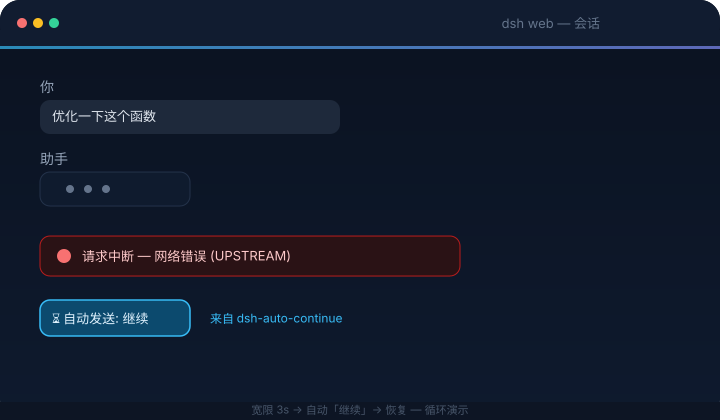
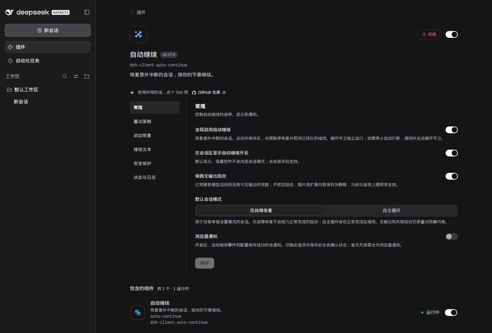
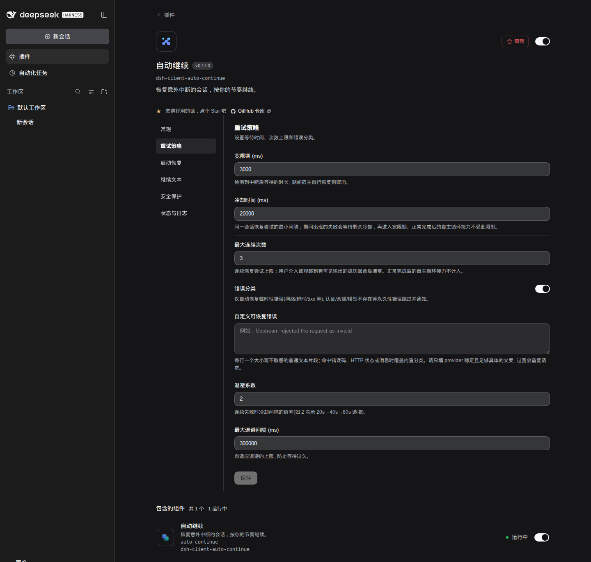
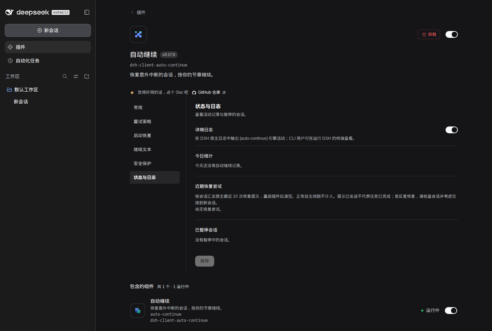

<p align="center">
  <picture>
    <source media="(prefers-color-scheme: dark)" srcset="docs/banner-zh-dark.svg">
    
  </picture>
</p>

<h1 align="center">dsh-auto-continue</h1>

<p align="center">
  <em>自动恢复中断的 DSH 会话，也可选择开启自主循环，在正常完成后继续工作。</em>
</p>

<p align="center">
  <a href="https://www.npmjs.com/package/dsh-client-auto-continue"></a>
  <a href="https://www.npmjs.com/package/dsh-client-auto-continue"></a>
  <a href="https://github.com/HsiangNianian/dsh-auto-continue/stargazers"></a>
  <a href="https://github.com/HsiangNianian/dsh-auto-continue/blob/main/LICENSE"></a>
  <br>
  <a href="https://awesome-dsh-plugin.com"></a>
  <a href="https://www.dsh.so/artifact/dsh-auto-continue/"></a>
  <br>
  
  
  
</p>

<p align="center">
  <a href="README.md">English</a> · <b>中文</b> · <a href="CHANGELOG.md">更新日志</a>
</p>

---

## 它做什么

为 [DeepSeek Harness](https://github.com/deepseek-ai/deepseek-harness) 的 Web 界面和桌面应用提供自动恢复。会话因可恢复错误中断时，插件通过 DSH 发送你配置的继续提示。引擎运行在**宿主进程**中，浏览器标签页关闭后仍会工作，多个标签页共享同一个引擎。默认开启中断恢复；成功回合后也继续工作的**自主循环需要手动开启**。

<p align="center">
  <picture>
    <source media="(prefers-reduced-motion: reduce)" srcset="docs/demo-zh-static.svg">
    
  </picture>
</p>

**智能恢复**(全部可配置):

- **会话模式** — 在输入框旁用开关控制当前会话的自动继续，旁边显示当前模式的菜单可选择跟随默认、关闭、仅故障恢复或自主循环。选择保存在宿主配置里，重启后保留，并同步到其他标签页。隐藏控件不会改变模式
- **错误分类** — 临时性错误（网络 / 超时 / 5xx / 429 等）自动续跑；被归类为永久性的错误会跳过并通知。包括 HTTP 401/403，或非 `MALFORMED_RESPONSE` 错误的 code/message 命中认证、凭据/API Key、余额/配额、模型不存在、上下文长度/超限等关键词。服务商专属例外可通过自定义普通文本匹配设置；关闭分类后，所有错误都可尝试恢复
- **自适应退避** — 连续失败时等待时间递增（冷却 × 系数：20s → 40s → 80s…），直到配置的最大间隔
- **断网挂起** — 默认开启（`pauseWhenOffline`）。网络类失败（`TRANSPORT`、`TIMEOUT`、DNS 或连接错误）续跑前，宿主先检测是否联网：有非回环网卡，且至少一个公共域名能解析。断网时挂起，每 `offlineCheckMs`（15 秒）复检一次，不消耗**最大连续次数**；联网后照常走宽限期和冷却再续跑。服务端错误（5xx、429）不挂起。设置了 `HTTP(S)_PROXY` / `ALL_PROXY` 时只检查网卡，因为这类代理下本地 DNS 可能本来就不可用
- **中英文本地化** — 设置卡片使用 DSH 的语言服务。内置续跑 / 护栏 / 循环文案以及浏览器通知在 `zh` 和 `zh-*` 时使用中文（不区分大小写），其他语言或未设置语言时使用英文。切换语言只会替换内置默认值，不会覆盖用户自定义文本
- **模板化继续文本** — `continueText` 支持 `{code}` `{message}` `{status}` `{tool}` `{turn}` `{errorCount}` `{elapsed}` 占位符, 续跑消息可携带失败上下文(如「继续 (git push 失败: UPSTREAM)」); 达到 `max-tokens` 时使用**另一套模板**(如「继续输出, 不要重复已生成的内容」)
- **幂等护栏** — 续跑前检查上一步工具调用：结果未确认时（如执行中断的 `git push`），提示模型先核实状态、不要重复执行；已确认成功时，提示模型继续而不重复执行。失败的工具调用不附加护栏文本。两段文本均可配置（支持 `{tool}` / `{result}` 占位符）
- **无输出回合续跑** — 正常结束的回合中，已观察到模型活动但没有可见输出时自动恢复。文本、工具调用、图片、扩展块及流式输出均算可见输出。未观察到模型活动的回合不触发，除非有显式 `no-visible-output` 结束标记；这类回合在重启后也可恢复。关闭**续跑无输出回合**会取消排队中的静默续跑。无论此选项是否开启，无输出回合都不会清零连续尝试次数。
- **自主循环** — 默认关闭（`resumeCompletedTurns`）。开启后，正常完成的回合经过宽限期便会续跑，不受恢复冷却和次数上限约束。仅有推理的回合和显式 `no-visible-output` 仍消耗重试预算并遵守退避。全局暂停、会话暂停、手动停止或将该会话改为仅故障恢复 / 关闭都会停止循环。默认模式只影响选择了「跟随默认」的会话。自主循环使用单独的提示文本 `continueTextLoop`（默认 `继续`），与循环守卫的提示文本不同。 `loopMaxIterations` 限制每个会话的自主续跑轮数（默认 0，不限制）：到达上限后循环停下并提示一次（日志，开启通知时另有浏览器通知）；你自己发一条消息或重新开启循环后重新计数
- **暂停** — 在**常规**中关闭**全局启用自动继续**并保存，会停止实时事件与启动扫描触发的自动发送; 会话级暂停(如通过通知按钮)只挂起单个会话, 到期自动恢复。即使两种暂停同时生效，通知里的 **立即续跑** 仍可发送一次。发送后保留暂停状态，后续自动恢复和自主循环仍受暂停约束
- **通知按钮** — 通知带 **立即续跑**(无视冷却、连续上限与暂停, 马上发送)和 **暂停该会话 1 小时** 按钮
- **子会话交接** — 需显式开启（`resumeInterruptedChildren`，默认关）：启动扫描发现子代理 / 团队成员会话被重启打断时，每个 **root 会话**只会收到一条列出这些子会话的消息，同一批只发一次。子会话本身仍然永不被续跑 —— 由 root 决定逐个继续还是收尾。只有父会话自己干净结束、或自己也是被这次重启关闭的时候才会接受唤醒；父会话自己仍在进行中的回合交给原有恢复路径，被你手动停止的父会话绝不唤醒
- **goal 重新武装** — 需显式开启（`resumeGoals`，默认关）：任一次自动续跑（或子会话唤醒）发出后，把重启时被宿主失活的 `active` goal 重新武装，让它的自动继续轮重新转起来。**恢复被暂停的 goal**（`resumePausedGoals`）还会恢复你手动暂停的 goal，且必须同时开启 `resumeGoals` 才生效
- **循环守卫** — **运行中的回合**出现以下重复行为时，取消回合并用可配置的循环提示文本重启：连续输出完全相同的消息（不限长度）、单条流式消息内连续出现近似重复段落、时间窗内连续多条短句且无工具调用，或反复调用同一工具且**参数与结果均相同**。工具参数或结果变化视为有进展。用户手动停止不会触发守卫重启。阈值、时间窗与提示文本均可配置
- **统计面板** — 设置卡片展示今日自动继续次数、恢复成功、继续后失败、永久性跳过、达上限停止、循环打断, 按错误码统计, 可一键清零
- **浏览器通知** — 可选：自动继续事件和配置保存成功时弹出提醒。切换通知选项并保存后会确认新状态，关闭时也会发最后一条确认。开启时可能请求浏览器权限；被拒绝后会在设置页说明，不影响配置保存。

插件监听实时事件流, 对以下情况作出反应:

| 事件 | 含义 |
| --- | --- |
| `turn/end` → `error` | 回合失败(模型 / 网络 / 超时等) |
| `turn/end` → `interrupted` | 宿主崩溃重启后遗留的中断回合(由启动扫描恢复) |
| `turn/end` → `max-tokens` | 达到输出 token 上限 |
| `turn/end` → `completed` / `no-visible-output` 且无可见输出 | 已观察到模型活动但没有可见输出，或收到显式无输出结束标记 |
| `turn/end` → `completed` | 仅在开启自主循环时续跑正常完成的回合 |

每类回合各自会不会被续跑，以及由哪个开关约束：

| 场景 | 是否自动续跑 | 触发路径 | 受哪个开关约束 |
| --- | --- | --- | --- |
| 本会话的回合失败、达到输出上限，或被宿主重启截断 | 会 —— 在同一会话内发一条续跑消息 | 实时事件，或重启后的启动扫描 | **全局启用自动继续**、会话模式、**启动恢复扫描**（`scanOnBoot`） |
| 本会话回合结束但没有可见输出 | 会 | 实时事件或启动扫描 | **续跑无输出回合**（`resumeSilentTurns`） |
| 本会话回合正常完成 | 仅在**自主循环**下 | `turn/end` → `completed` | `resumeCompletedTurns` / 会话模式 |
| 子代理或团队成员会话被重启打断 | **不会** —— 子会话永不直接被续跑 | 启动扫描收集清单，然后向它的 **root 会话**发一条唤醒消息 | `resumeInterruptedChildren`（默认关） |
| 会话带有被重启失活的 `active` goal | 不会自动发生：续跑出去的回合需要 goal 重新武装 | 该会话任一次自动续跑之后 | `resumeGoals`（默认关） |
| 会话带有你手动暂停的 goal | 仅在你显式选择时 | 同上 | `resumeGoals` **与** `resumePausedGoals`（均默认关） |

**恢复会停止于：**用户手动停止、策略拒绝（`blocked`）、暂停、子代理会话以及连续次数上限。新回合开始或用户手动发送消息会取消待发送的继续提示；实时 `interrupted` 标记交给启动扫描处理。冷却期间出现的可恢复错误会**延后重试，不会直接丢弃**。已有排队消息时，插件尝试优先处理续跑消息，并保持用户消息的原有顺序。循环守卫则可以单独打断并重启正在重复动作的回合。

子代理会话由父代理管理。插件会在实时恢复和启动扫描中跳过它们，忽略对它们发起的 **立即续跑**，循环守卫也不会打断它们。识别出子代理会话时，已排队的恢复操作会被取消。可选的**重启后唤醒子代理会话**（`resumeInterruptedChildren`，默认关闭）不改变这一点：插件仍然绝不续跑子会话，只是把「哪些子会话被重启打断」告诉它们的 root 会话，由 root 决定继续还是收尾。

---

## 工作原理

恢复功能在 DSH 宿主中运行，多个浏览器标签页共享。中断后先等待一个**宽限期**（默认 3 秒），再发送配置的文本。新回合开始（`turn/start`）会取消待发送的继续提示。续跑消息通常优先于排队中的用户消息执行；若队列顺序调整失败，则排在这些消息之后。用户消息保持原有顺序。

宿主启动时，插件还会检查已保存的会话，包括尚未重新打开的对话。**扫描时间窗**（默认 15 分钟）内符合恢复条件的中断，若其后没有新回合（`turn/start`）或用户消息，就会自动恢复。恢复时沿用会话的预设与已记录的模型，也适用于宿主重启时仍在运行的回合。

若某个会话的历史无法读取或包含无效事件，本次启动扫描会跳过该会话并记录错误，其他符合条件的会话仍可恢复。修复会话历史后，重启 DSH 以重新扫描；中断时间仍须处于扫描时间窗内。空历史或仍在加载的会话会在时间窗内重新检查。详见 [#58](https://github.com/HsiangNianian/dsh-auto-continue/issues/58)。

在浏览器中可配置恢复、选择会话模式、查看统计与已暂停会话，并接收可选通知，通过**立即续跑 / 暂停该会话 1 小时**操作会话。

### 恢复流程

下图汇总了自动恢复主链、循环守卫重启路径和等待人工介入的出口。点击图片可查看原尺寸版本。

[](docs/auto-continue-workflow.svg)

## 快速开始

DSH 插件安装进 **profile**(`dsh web` 对应 `web` profile)。下面的命令用于 Web 版, 安装后重启 `dsh web`。桌面版请通过应用内的**插件**页面安装。

### 版本兼容

| DSH 内核 | 插件版本 | 配置入口 |
| --- | --- | --- |
| **0.2.2-rc.1** | **已验证 0.18.0** | **插件 → dsh-client-auto-continue** |
| **0.2.1-rc.2** | **已验证 0.18.0** | **插件 → dsh-client-auto-continue** |
| **0.2.1-alpha.1** | **已验证 0.18.0** | **插件 → dsh-client-auto-continue** |
| **0.2.0-rc.1** | **0.12.1 或更新版本** | **插件 → dsh-client-auto-continue** |
| **0.1.7-rc.2** | **0.11.9 或更新版本** | 同上，从主侧栏的插件页进入 |
| 使用旧设置 API 的宿主 | 保留旧版设置界面兼容 | **设置 → 插件 → 插件配置** |

不支持 DSH 0.1.0-rc.6 及更早版本。自动化设置与兼容测试覆盖 **0.1.7-rc.2**、**0.2.0-rc.1**、**0.2.1-alpha.1** 和 **0.2.1-rc.2**，启动恢复测试还覆盖 **0.2.0-rc.2** 和 **0.2.1-alpha.1**。桌面应用版本不等于内置的 DSH 内核版本，请按内核版本判断兼容性；CLI 可运行 `dsh --version`，可用版本见 [DSH 官方 Releases](https://github.com/deepseek-ai/deepseek-harness/releases)。

**插件 0.11.9 和 0.12.0 会被 DSH 0.2.0-rc.1 的版本检查拦截。** 请升级到 0.12.1 或更新版本；现有配置表单接口可在该内核正常工作。详见 [#50](https://github.com/HsiangNianian/dsh-auto-continue/issues/50)。

当前 DSH 的**设置 → 内置插件**是组件状态列表，配置应从主侧栏的**插件**页面进入。下方截图展示插件 **0.14.0** 在 **DSH 0.2.1-alpha.1** 中的界面。此前通过软链或手写 Loader 条目安装的用户，请参考[旧安装迁移](#旧安装迁移)。

### 从 npm 安装(推荐)

已发布为 [`dsh-client-auto-continue`](https://www.npmjs.com/package/dsh-client-auto-continue):

```bash
dsh plugin --profile web add dsh-client-auto-continue@latest
dsh web
```

### 更新已安装的插件

等当前任务结束后停止 DSH，再次执行上面的 npm 安装命令，用 `@latest` 更新插件，然后重启 DSH 并刷新浏览器。已有配置覆盖项会保留。桌面版请从应用内的**插件**页面更新并重启应用；更新 CLI 的 `web` profile 不会同步更新桌面版的 profile。

### 直接从 GitHub 安装(无需克隆)

直接从仓库默认分支安装——构建产物已提交入库, 无需本地克隆或构建:

```bash
dsh plugin --profile web add github:HsiangNianian/dsh-auto-continue
dsh web
```

> 该方式跟踪 `main` 分支而不是发布 tag——适合尝鲜最新改动, 稳定性首选上面的 npm 方式。切换安装来源只需重新执行 `dsh plugin --profile web add <其他来源>`, profile 依赖会被就地替换。

### 从本仓库安装

请使用与 CI 相同的 Node.js 22。

```bash
git clone https://github.com/HsiangNianian/dsh-auto-continue.git
cd dsh-auto-continue
npm ci
npm run build

# 包自带 cordis.patch.yml(通过 dsh.bundle.patch 声明),
# 插件行会自动注册
dsh plugin --profile web add "link:$(pwd)"

dsh web
```

### 旧安装迁移

手动添加 Loader 条目可以启动引擎, 但未必会在**插件**页面登记 bundle。请通过 profile 的包管理命令安装; 不再推荐只创建软链并添加 `insert` 条目。

1. 等当前任务结束后停止 `dsh web`。备份 `~/.dsh/profiles/web/` 下的 `package.json`、`cordis.patch.yml`、`pnpm-lock.yaml`, 以及存在时的 `~/.dsh/settings.yaml`。如果设置了 `DSH_HOME`, 请用该目录替代 `~/.dsh`。
2. 保留已有的自动继续参数。只删除 **`insert` 列表内**手动添加的 `auto-continue` 行; 若列表因此变空, 一并删除空列表。安装包会提供该行。顶层的 `- id: auto-continue` 搭配 `config:` 是配置覆盖项, **应当保留**。
3. 使用上面的 npm 或 GitHub 命令安装。profile 的 `package.json` 中, `dsh.profile.bundles` 应在原有 DSH bundles 之外包含 `dsh-client-auto-continue`。如果已经包含, 且**插件**页面已有该插件, 这一步已经完成。
4. 在 DSH 0.1.7 / 0.2 上, 将旧 `settings.yaml` → `auto-continue` 段落或已移除条目的 `config` 参数合并到 profile 的 `cordis.patch.yml`。例如, 自定义冷却时间写成:

   ```yaml
   - id: auto-continue
     config:
       cooldownMs: 45000 # 示例: 请保留你原先设置的值
   ```

   若已有覆盖项, 请合并到其中, 不要重复添加。保留其他设置。DSH 0.1.7 / 0.2 读取的是条目配置, 修改旧 `settings.yaml` 段落不会更新新版表单。
5. 重新启动 `dsh web` 并刷新浏览器。打开**插件 → dsh-client-auto-continue**, 选择对应的设置类别，检查旧参数是否保留。保存一次修改并刷新, 确认配置持久化正常。

**内置插件**里显示的 `include:auto-continue` 是正常的 Loader 前缀, 单凭这个名字不能判断为旧安装或重复引擎。

对于同时提供新版 profile 配置和旧版设置 API 的宿主（[#64](https://github.com/HsiangNianian/dsh-auto-continue/issues/64)），插件使用 profile 配置。每个 profile 会从 `$DSH_HOME/settings-legacy.yaml` 的 `auto-continue` 段落迁移一次旧值，包括暂停状态和自定义提示词；已有的 profile 配置优先。原文件及其他插件的配置保持不变。重置配置后，重启也不会再次导入旧值。

迁移期间，自动恢复和循环守卫暂不执行。如果旧文件无法读取、参数校验失败或 profile 无法保存，宿主会记录迁移错误，并继续保持两者暂停。修复文件或 profile 权限后重启宿主即可重试。只支持旧版 API 的宿主继续使用原来的设置存储。

### 验证与卸载

```bash
dsh --profile web --dump-config | grep -A 4 'id: auto-continue'
```

合并后的配置应只有一个 `id: auto-continue` 条目。在**插件 → dsh-client-auto-continue**中确认组件**运行中**, **常规**分类中能编辑字段。开启详细日志后, 引擎活动会输出到运行 DSH 的终端。

```bash
dsh plugin --profile web remove dsh-client-auto-continue   # npm / 仓库安装
# cordis.patch.yml 中若有该插件的配置覆盖项, 也一并移除
dsh web
```

---

## 常见问题

- **提示 “skipping profile bundle” 或 “incompatible with dsh 0.2.0-rc.1”：** 在应用实际使用的 profile 中升级到插件 0.12.1 或更新版本，再重启应用。此修复不需要授予版本豁免。
- **已启用，但看不到配置：** 从主侧栏打开**插件**，选择该包并打开**常规**；内置插件状态页没有可编辑字段。
- **`/api/auto-continue-bridge` 返回 404：** 检查 DSH 启动日志与合并配置，确认宿主组件已安装并加载后，再刷新设置页。

---

## 会话模式

输入框旁的**自动继续**开关只影响当前会话，修改后立即保存。关闭开关会选择「关闭」，重新开启会选择「跟随默认」；旁边的模式菜单可切换模式：

| 模式 | 行为 |
| --- | --- |
| 跟随默认 | 使用设置页中的「默认会话模式」，初始为仅故障恢复 |
| 关闭 | 不自动发送继续，也不通过循环守卫打断该会话 |
| 仅故障恢复 | 恢复符合条件的故障和无输出回合，正常完成后不接力 |
| 自主循环 | 正常完成后也自动续跑，使用自主循环提示文本 |

例如，A 自主循环，B 仅故障恢复，C 关闭，三者互不影响。各会话的选择保存到宿主 profile 配置（`sessionModes`），跨标签页同步，宿主重启后保留。选择「跟随默认」会移除该会话的独立模式设置（包括继承的覆盖项），改用默认模式。

**常规 → 全局启用自动继续**仍是总开关。关闭并保存后，所有会话停止自动续发，但各会话的选择保持不变；重新启用后继续按各自模式工作。关闭某个会话会取消宽限期、冷却期和循环守卫重启的待发送任务，正在运行的回合保持运行。从自主循环切到仅故障恢复也会取消待发送的自主续跑。重新启用不会恢复已经取消的发送。

通知中的**暂停该会话 1 小时**仍然临时暂停一个会话。**立即续跑**可在暂停或关闭状态下发送一次，不改变保存的模式。全局循环守卫仍独立于全局暂停，但设为关闭的会话也会退出循环守卫。

想隐藏控件时，进入**插件 → dsh-client-auto-continue → 常规**，关闭**在会话区显示自动继续开关**，再点**保存**。这只改变显示（`showComposerToggle`，默认 `true`）。不支持会话区控件的宿主仍可使用设置卡片。保存失败时会显示 DSH 通知；宿主持续不可用超过 3 秒会提示一次。宿主断开或设置不可写时，开关和模式菜单不可操作。输入框变窄时，文字和模式菜单会收为图标和箭头，让控件保持在同一行。

DS-Bot / dsh-pocket 在屏幕宽度不超过 **640 CSS 像素**时也使用此紧凑布局，暂停和错误提示放在下方。更新插件后，重启 DSH 并刷新远程页面，即可加载新样式。

## 配置

在 **DSH 0.1.7 / 0.2** 中, 从主侧栏打开**插件**, 选择 **dsh-client-auto-continue**, 再选择设置类别。**设置 → 内置插件**是单独的组件状态列表, 不能在其中编辑配置。旧版 DSH 的入口仍为**设置 → 插件 → 插件配置**。



通过**常规、重试策略、启动恢复、继续文本、安全保护、状态与日志**查找选项。切换分类会保留未保存的修改；**状态与日志**中可以查看今日统计、近期恢复尝试和已暂停会话。

**近期恢复尝试**按会话汇总宿主最近 20 次恢复提示，展示窗口内次数、最近原因、时间与最近发送时的连续次数，关闭浏览器通知也可查看。原因区分无可见输出、输出上限、请求错误、宿主重启中断、循环守卫恢复与手动续跑，不计正常自主续跑。历史不包含消息正文，重启插件后清空。

设置卡片显示 GitHub 邀请入口和分类导航。插件管理页显示插件名称、版本和启用状态。修改配置后点**保存**才生效。

开启**浏览器通知**后，每次保存成功都会从当前操作的标签页发出一条确认。关闭通知时，如果浏览器已授权，会发最后一条关闭确认，之后保存其他配置不再通知。如果浏览器拦截通知，设置页仍会确认保存结果并说明权限问题。

DSH 0.1.7 / 0.2 将这些值保存在当前 profile patch 的 `auto-continue` 条目 config 中(默认 Web profile 对应 `~/.dsh/profiles/web/cordis.patch.yml`)。点**保存**后实时生效, 无需重启引擎。省略的字段使用下表默认值。

启动恢复每三秒检查一次延迟加载的会话，直到引擎启动后的 `freshMs` 时间窗结束。每个已就绪会话的历史只检查一次；`scanLimit` 限制每轮符合条件的恢复数量，无需恢复的会话不计入。暂停会挂起恢复，但不会延长时间窗；停用插件会结束扫描。

内置文案通过 `locale` 跟随 DSH 语言：`zh` 和 `zh-*`（不区分大小写）使用中文，保存为 `zh`；其他语言或未设置语言时使用英文（`en`）。旧配置中的 `ru` 等值也使用英文。更新插件后，重启 DSH 并刷新全部标签页，可同步保存的语言。本地化文本字段留空或省略时自动跟随语言；非空值视为自定义模板，切换语言时保持不变：

```yaml
- id: auto-continue
  config:
    locale: 'zh' # 通常由浏览器自动维护
    paused: false
    showComposerToggle: true
    usePluginSource: false
    continueText: ''
    resumeSilentTurns: true
    resumeCompletedTurns: false
    resumeInterruptedChildren: false # 启动恢复：把被打断的子会话清单告诉 root 会话
    resumeGoals: false # 重试策略：重新武装被重启失活的 goal
    resumePausedGoals: false # 重试策略：连手动暂停的 goal 也恢复（需先开 resumeGoals）
    pauseWhenOffline: true # 重试策略：宿主断网时挂起网络类错误的续跑
    offlineCheckMs: 15000
    loopMaxIterations: 0 # 每个会话的自主循环轮数上限；0 为不限制
    continueTextSilent: ''
    continueTextLoop: ''
    continueTextInterrupted: ''
    continueTextMaxTokens: ''
    guardTools: true
    guardPendingText: ''
    guardDoneText: ''
    graceMs: 3000
    cooldownMs: 20000
    maxConsecutive: 3
    scanOnBoot: true
    scanLimit: 8
    freshMs: 900000
    verbose: true
    classify: true
    retryableErrorPatterns: ''
    backoffFactor: 2
    backoffMaxMs: 300000
    notify: false
    loopGuard: true
    loopShortChars: 40
    loopWindowMs: 30000
    loopShortCount: 12
    loopRepeatText: 4
    loopToolRepeat: 5
    loopText: ''
```

<details>
<summary>旧版 DSH 的配置文件</summary>

旧版宿主将用户设置保存在 `~/.dsh/settings.yaml` 的插件命名空间下, 而非 profile 条目中:

```yaml
auto-continue:
  cooldownMs: 45000
```

从旧设置文件迁移到 DSH 0.1.7 / 0.2 时, 请按[旧安装迁移](#旧安装迁移)将这些值移入 profile 条目的 `config`。

</details>

**卡片操作说明:**



- 修改是**暂存式**的——点「保存」之前不会写入磁盘; 离开页面会丢弃未保存的草稿
- 保存期间继续修改或重置字段时，新的草稿会保留在卡片中；等待当前保存结束后，再点一次「保存」即可应用
- 有覆盖项的字段提供「恢复默认」按钮（移除覆盖项，恢复继承值，通常为内置默认值）
- 布尔选项使用原生开关，点保存后生效；「恢复默认」会移除覆盖项并恢复继承值。**全局启用自动继续**开启表示允许恢复（`paused: false`）
- 非法输入（非数字、小于最小值）会阻止保存，并标记所在分类，切换分类后仍能找到问题
- 只读部署中卡片只显示已存值, 编辑控件禁用，仍可切换分类查看
- 保存后立即生效，持久化在当前 profile 配置中（旧版宿主使用 `~/.dsh/settings.yaml`）

<details>
<summary>现场状态与原生保存按钮</summary>



</details>

下表中的中文文案对应 `locale: zh`；未设置语言时使用英文默认文案（如 `Continue`）。

| 字段 | 默认 | 说明 |
| --- | --- | --- |
| 暂停自动继续 | 关 | 全局暂停: 实时与扫描都不再自动发送, 已排队的待发送也会取消 |
| 在会话区显示自动继续开关 | 开 | 显示会话开关和模式菜单（`showComposerToggle`）；隐藏不会改变模式 |
| 以插件来源发送继续消息 | 关 | `usePluginSource`：关闭时沿用旧版 `user` 来源；开启时使用 `plugin:dsh-client-auto-continue` |
| 继续文本 | `继续` | 中断后自动发送的消息内容 |
| 超限时的继续文本 | `继续` | 达到输出 token 上限时自动发送的文本(支持相同占位符) |
| 续跑无输出回合 | 开 | 回合正常结束但只有推理(没有文本、没有工具调用)时自动续跑; 不清零连续次数 |
| 无输出回合的继续文本 | `继续。你上一轮只输出了内部推理, ...` | 续跑无输出回合时发送的文本(支持相同占位符) |
| 默认会话模式 | 仅故障恢复 | 用于跟随默认的会话；沿用 `resumeCompletedTurns` 配置（`false` 为仅故障恢复，`true` 为自主循环） |
| 自主循环轮数上限 | `0` | 每个会话最多自主续跑的轮数（`loopMaxIterations`），`0` 为不限制；你发消息或重新开启循环后重新计数 |
| 自主循环的继续文本 | `继续` | 自主循环续跑时发送的文本(支持相同占位符) |
| 宿主重启后恢复的继续文本 | `继续。宿主在你上一轮运行期间重启了; …` | 启动扫描恢复被重启中断的会话时发送的文本(支持相同占位符) |
| 幂等护栏 | 开 | 续跑前检查上一步工具调用并给出指引(见「它做什么」) |
| 循环守卫 | 开 | 检测运行中的回合空转并重启(见「它做什么」) |
| 短句长度上限 (字符) | `40` | 模型消息文本短于该值计为一条短句(空转信号) |
| 短句时间窗 (ms) | `30000` | 在此时间窗内连续出现的短句计入短句阈值 |
| 连续短句阈值 | `12` | 时间窗内连续多少条短句且期间无工具调用时判定空转循环 |
| 相同消息重复次数 | `4` | 连续输出多少条完全相同的消息时触发循环守卫（不限长度）；同一阈值也用于单条流式消息内连续出现的近似重复段落 |
| 同工具重复次数 | `5` | 同工具+同参数+同结果的连续调用多少次时判定死循环 |
| 循环提示文本 | `(检测到你可能陷入循环, 请停止重复刚才的动作, 换一种方式继续)` | 打断后重启回合时发送的文本; 支持 {tool} 占位符 |
| 结果未确认时的护栏文本 | `(上一步工具「{tool}」可能未完成, 先确认状态再继续, 不要重复执行)` | 上一步工具可能已部分执行时附加; 支持 {tool} 占位符 |
| 工具已成功时的护栏文本 | `(上一步工具「{tool}」已完成, 结果: {result}; 不要重复执行, 直接继续)` | 上一步工具已确认成功时附加; 支持 {tool} / {result} 占位符 |
| 宽限期 (ms) | `3000` | 中断后等待的时长; 期间宿主自行恢复则取消 |
| 冷却时间 (ms) | `20000` | 同一会话恢复尝试的最小间隔；期间出现的失败会等待剩余冷却，再进入宽限期 |
| 最大连续次数 | `3` | 连续恢复尝试上限；用户介入或观察到有可见输出的成功回合后重置。正常完成后的自主循环接力不计入 |
| 断网时暂停续跑 | 开 | **重试策略** —— 宿主断网时挂起网络类错误的续跑，不消耗连续次数（`pauseWhenOffline`） |
| 断网复检间隔 (ms) | `15000` | **重试策略** —— 挂起期间多久重新检测一次网络（`offlineCheckMs`，最小 1000） |
| 重新武装被重启失活的 goal | 关 | **重试策略** —— 自动续跑发出后，把重启时被宿主失活的 `active` goal 重新武装，让它的自动继续轮能重新运转（`resumeGoals`）。`goals.resume` 在服务层不做人类授权校验，插件自动调用等于代替你授权 —— 所以默认关闭 |
| 恢复被暂停的 goal | 关 | **重试策略** —— 同时恢复你手动暂停的 goal（`resumePausedGoals`）。暂停通常是人的显式决定；只有同时开启**重新武装被重启失活的 goal**时才生效 |
| 启动恢复扫描 | 开 | 恢复启动时间窗内延迟加载的中断会话 |
| 扫描会话数 | `8` | 每轮最多恢复的符合条件的会话数，优先最近活动的会话 |
| 扫描时间窗 (ms) | `900000` | 中断的最大年龄，同时限制启动轮询的持续时间 |
| 重启后唤醒子代理会话 | 关 | **启动恢复** —— 启动扫描发现子代理 / 团队成员会话被重启打断时，向它们的 root 会话发一条列出清单的消息（`resumeInterruptedChildren`）。子会话永不直接被续跑；每轮最多冷读 8 个子会话日志，与**扫描会话数**相互独立 |
| 详细日志 | 开 | 在运行 DSH 的终端输出 `[auto-continue]` 引擎日志 |
| 错误分类 | 开 | 仅自动恢复临时性错误; 认证 / 余额 / 模型等永久性错误跳过并通知 |
| 自定义可恢复错误 | 空 | 每行一个大小写不敏感的普通文本片段; 命中错误码、HTTP 状态或消息时显式覆盖内置分类 |
| 退避系数 | `2` | 连续失败时冷却间隔的倍率(2 = 20s → 40s → 80s…) |
| 最大退避间隔 (ms) | `300000` | 自适应退避的上限 |
| 浏览器通知 | 关 | 自动继续事件和配置保存成功时通知；切换通知开关并保存后确认状态 |

暂停自动继续会停止自动续跑，但循环守卫仍独立运行。如需停止自动打断，请同时关闭**循环守卫**。仅含不可见字符的正文不计入可见消息复读；新的工具调用会重置正文重复计数，而同工具、同参数、同结果的工具死循环仍独立检测。

`MALFORMED_RESPONSE` 格式错误会允许重试，即使回显的工具参数包含 `auth`、`permission`、`quota` 等词。内置分类仍会跳过明确的 HTTP 401/403，冷却、退避和重试上限照常生效。实时错误和启动扫描均适用；[#75](https://github.com/HsiangNianian/dsh-auto-continue/issues/75) 中临时添加的 `malformed_response` / `non-whitespace character after json` 两条匹配已不再需要。

遇到确认可以安全续跑的 provider 专属错误时(先确认手动发送「继续」确实能恢复), 应添加足够具体、稳定的片段, 而不是全局关闭错误分类:

```yaml
- id: auto-continue
  config:
    retryableErrorPatterns: |-
      Upstream rejected the request as invalid
```

匹配项是普通子串, 不是正则表达式。空行会被忽略; 任一行命中后会优先于内置永久错误规则。冷却与最大连续次数仍然生效。

`continueText`（以及 `continueTextMaxTokens`、`continueTextSilent`、`continueTextLoop`、`continueTextInterrupted`）支持占位符 `{code}`、`{message}`、`{status}`、`{tool}`(失败前最后一次工具调用)、`{turn}`、`{errorCount}`(连续失败次数, 含本次)和 `{elapsed}`(距失败经过的时间, 如 `1m5s`)——例如 `继续 ({tool}: {code})` 会变成 `继续 (git push: UPSTREAM)`。`continueTextInterrupted` 在启动扫描恢复被宿主重启中断的会话时发送, 默认文本会说明重启并要求先核实外部状态再重试。护栏文本支持 `{tool}` 与 `{result}`(上一步工具输出的截断摘要)。当前宿主引擎会将 `{sessionTitle}` 替换为空字符串。

---

## 隐私与权限

恢复引擎运行在 DSH 宿主进程中, 浏览器负责配置卡片、实时状态和可选通知:

- 引擎通过 DSH 服务读取会话事件和历史, 浏览器与该宿主通信; 插件不新增第三方服务或凭据存储
- 恢复时通过 `agent.followup` 发送你配置的文本。循环守卫可先通过 `agent.cancel` 停止空转回合, 再发送恢复提示; 续跑的 Agent 沿用会话已有的工具和权限
- 保存配置使用 DSH 的设置 API: DSH 0.1.7 / 0.2 写入当前 profile patch, 旧版宿主写入 `~/.dsh/settings.yaml`
- 重试计数、冷却时间戳、通知里的限时暂停与统计保存在宿主进程内存中，引擎重启后重置；会话模式（`sessionModes`）和全局 `paused` 随其他配置持久化保存
- 浏览器通知是可选开启的（`notify` 设置）。开启并保存时可能请求浏览器权限；被拒绝后不再请求，关闭此选项也不会请求权限。

---

## 开发

使用 Node.js 22，安装锁定版本的运行时测试环境，即可在本地执行 CI 检查：

```bash
npm ci
npm ci --prefix tests/fixtures/dsh-0.1.7
npm ci --prefix tests/fixtures/dsh-0.2.0
npm ci --prefix tests/fixtures/dsh-0.2.0-rc.2
npm ci --prefix tests/fixtures/dsh-0.2.1
npm ci --prefix tests/fixtures/dsh-0.2.1-rc.2
npm run typecheck
npm run build
npm test
npm run test:runtime
```

`npm test` 覆盖错误恢复、自主循环上限与开关、子会话排除与重启后交接、暂停期间手动续跑、启动扫描及畸形会话隔离、队列顺序、统计、本地化、设置界面生命周期及保存期间继续编辑的情况。`npm run test:runtime` 使用已发布的 DSH **0.1.7-rc.2**、**0.2.0-rc.1** 和 **0.2.1-alpha.1** Settings、Loader、HTTP 组件，并运行真实的 0.2 profile 兼容检查及缺少其中一种设置服务时的客户端激活测试。启动恢复测试在真实的 **0.2.0-rc.2** 和 **0.2.1-alpha.1** Session、Cordis、HTTP 组件中注入会话读取故障，验证其他会话仍能恢复。运行时测试使用受控的 agent 事件，不会向模型服务发送请求。

rc.2 测试还加载已发布的客户端设置服务，使用不再包含 `mode` 的真实快照，验证卡片保存/重置、会话模式、并发保存、磁盘重新加载、语言同步与重新读取宿主配置。

rc.2 重启测试使用真实的 agent、query 与 JSONL 持久化服务：在回合中强制结束宿主，启动新宿主且不打开会话，验证仅恢复一次，并沿用已记录的模型与对应提示变量。模型适配器使用确定性响应，不发送外部模型请求。

修改链接的本地仓库后，运行 `npm run build` 写入最新的 `lib/` 产物，再重启 DSH 并刷新浏览器。开启 client HMR 的宿主可自动重新加载已构建的客户端包。

CI 执行类型检查、构建、两组测试、已提交 `lib/` 产物校验及 [dsh-plugin-check](https://github.com/omdsh-dev/dsh-plugin-check)，发布也受这些检查约束。更新界面文档时请参考[截图采集说明](docs/screenshots/README.md)。

---

## 活跃度

[](https://gitstock.org/HsiangNianian/dsh-auto-continue)

---

## 链接

- **仓库**: [github.com/HsiangNianian/dsh-auto-continue](https://github.com/HsiangNianian/dsh-auto-continue)
- **LINUX DO**: [linux.do](https://linux.do)
- **DeepSeek Harness**: [github.com/deepseek-ai/deepseek-harness](https://github.com/deepseek-ai/deepseek-harness)
- **dsh-plugin-check**: [github.com/omdsh-dev/dsh-plugin-check](https://github.com/omdsh-dev/dsh-plugin-check) — 给自己的 DSH 插件仓库做健康体检

---

## License

[](LICENSE)

MIT © Hsiang Nianian
