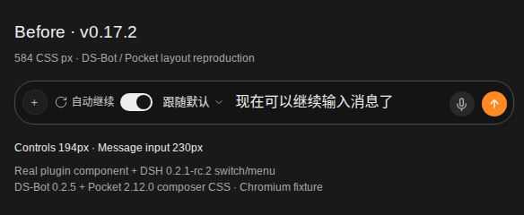
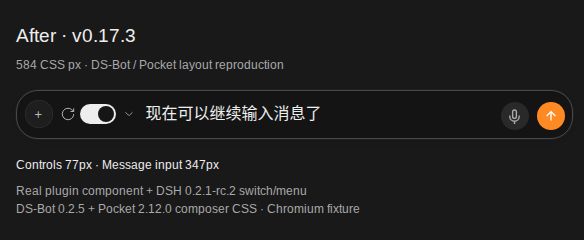

## Mobile composer layout

The compact viewport fallback now covers screens up to **640 CSS pixels**, fixing the remaining 461–640px gap reported in [#72](https://github.com/HsiangNianian/dsh-auto-continue/issues/72)

DS-Bot can remove the composer's size-query container with `display: contents`, so container queries cannot compact the controls in that view. Extending the existing media query from 460px to 640px also covers the reporter's 584px viewport

The icon, native switch and mode-menu arrow stay available, with pause and legacy error messages below. At larger viewport widths, the existing container-based behavior still applies

### Before and after at 584px

In our Chromium reproduction, the controls shrink from **194px to 77px** and the message input grows from **230px to 347px**





These screenshots use the real plugin component, DSH 0.2.1-rc.2's native switch/menu and the relevant DS-Bot 0.2.5 / dsh-pocket 2.12.0 styles in a minimal composer fixture

## Upgrade

Let current work finish, stop DSH, then update the profile you use

```bash
dsh plugin --profile web add dsh-client-auto-continue@0.17.3
dsh web
```

Desktop app users should update through the app's Plugins page and restart the app, since it uses its own profile

Reload open remote/browser pages after restarting so they load the new CSS. If you added a local CSS workaround, remove it after updating before checking the new layout. The breakpoint is measured in CSS pixels, not physical screen pixels; the mode options are still behind the arrow

## Validation

- Typecheck, build, full regression suite and DSH runtime compatibility tests
- Chromium checks at 351, 440, 460, 461, 584, 640, 641, 768 and 1024px, including paused, failed-save, read-only, saving, English, light-theme and intact-container variants
- Native switch, mode selection and editable input interaction
- 584 × 740 CSS-pixel mobile emulation with DPR 3

The reporter's actual Android device and a complete DS-Bot/Pocket session have not been tested

Thanks @jasoneri for the detailed follow-up and breakpoint measurements

**Full changes:** https://github.com/HsiangNianian/dsh-auto-continue/compare/v0.17.2...v0.17.3
